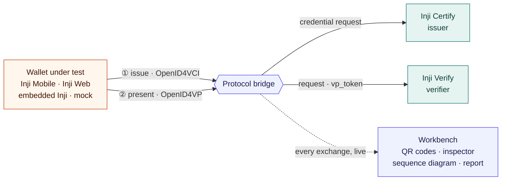

# Inji Interoperability Playground

A Postman-style workbench for the MOSIP Inji stack. Pick a wallet and a credential, issue it from **Inji Certify**, hold it in the wallet, present it to **Inji Verify**, and watch every OpenID4VCI and OpenID4VP exchange as raw JSON while it happens. Everything runs against the real services: no credential, signature or verdict is simulated.



## What it shows

- **Inji to Inji works.** A JSON-LD credential travels from Certify through the embedded Inji wallet or Inji Web to Verify and passes end to end.
- **Inji to a non-Inji wallet works.** An independent wallet receives an SD-JWT credential from Certify and presents it to Verify: PASS.
- **Inji Mobile works on a real phone.** An SD-JWT credential issued to Inji Mobile on an Android phone and shared back to Inji Verify passed end to end, with every check (run `2e588e58`, 1 November).
- **mDoc reaches the phone, not the verifier.** Inji Certify issues an ISO/IEC 18013-5 mDoc that Inji Mobile stores on a real phone (run `baf94774`); Inji Verify 0.17 cannot verify mDoc and rejects it.
- **Where it breaks.** Testing turned up 26 gaps. For example, Inji Verify 0.17 accepts an SD-JWT presentation with the wrong nonce, and Mimoto 0.21 cannot present SD-JWT. See [the gap report](docs/INTEROP_GAPS.md).

The full results are in the [interoperability matrix](docs/INTEROP_MATRIX.md), and the [coverage page](docs/PROBLEM_STATEMENT_COVERAGE.md) maps every task in the problem statement to what was built.

## Quick start

Requirements: Docker with about 6 GB of memory, and Node.js 22. From the repository root:

```bash
npm start
```

This renders the local configuration, then builds and starts the 12 services. Open the workbench at **https://inji.127.0.0.1.sslip.io/playground/** and accept the certificate warning. The embedded Inji wallet needs this HTTPS address; the other flows also work at http://localhost:5173. Sign in or create an account with **Step 0 · Create account / Sign in**; new accounts get a synthetic farmer record on first issuance. The seeded `farmer` account uses `LOCAL_FARMER_PASSWORD` from `.env`.

Other tasks (`stop`, `logs`, `rebuild:client`, `upgrade`, …) are in the root [package.json](package.json). Existing checkouts should use `npm start` (or `npm run prepare:config`) after pulling, because Compose reads rendered files such as `infra/inji/generated/origin.env`.

The shared development `.env` and `infra/inji/secrets/` are committed for the private team, so a clone needs no bootstrap step. Before the repository becomes public, remove both from history and run `npm run bootstrap` to create new private values. Do not trust `local-ca.crt` system-wide, because its private key is shared.

## Pick a flow

| Holder wallet | What it proves | Formats | You need |
| --- | --- | --- | --- |
| **Inji wallet · in this page** | Inji to Inji, without leaving the workbench | JSON-LD | The HTTPS workbench |
| **Inji Web · external** | Inji to Inji through the standalone browser wallet | JSON-LD (SD-JWT issues but cannot be presented) | A second tab |
| **Inji Mobile** | Inji to Inji on a phone | JSON-LD, SD-JWT, mDoc (stored; Inji Verify rejects it) | An Android phone and mobile mode |
| **Playground mock wallet · non-Inji** | Cross-ecosystem: an independent OpenID4VCI / OpenID4VP holder | SD-JWT | Nothing else |

Every run has the same three steps: **Configure → Issue & hold → Present & verify**. Choose the wallet, the credential and optionally a [test scenario](docs/SCENARIOS.md), then select **Start issuance**.

## Run each flow

### Inji wallet in this page

1. On the HTTPS workbench, select **Inji wallet · in this page** and the Farmer credential (JSON-LD).
2. Sign in through Keycloak, create or unlock your wallet with its PIN, and select **Authorize and receive credential**. Mimoto downloads and stores the credential, and the run moves on automatically.
3. Select **Request verification**, review the verifier and the full-credential disclosure, and select **Approve and share credential**.
4. The result card shows Inji Verify's verdict and the playground's own checks.

### Playground mock wallet

1. Select **Playground mock wallet · non-Inji** and the Farmer Credential (SD-JWT).
2. **Sign in and issue** opens Keycloak. After sign-in, the wallet proves possession of a fresh `did:jwk` key and stores the credential.
3. **Present with mock wallet** authenticates the verifier's signed request, checks its identity, endpoint, nonce, state and presentation definition, then discloses every claim with a Key Binding JWT.

The mock wallet is a minimal holder outside the Inji stack, registered in Keycloak as the public PKCE client `playground-mock-wallet`. Its traffic uses the public endpoints and passes through the bridge like any other wallet's.

### Inji Web

1. Select **Inji Web · external**, start issuance, and download the credential inside Inji Web.
2. Select **I received the credential** in the workbench once it appears in the wallet.
3. Request verification and use **Present with Inji Web** to open its `/authorize` flow, or scan the QR code.

Inji Web 0.16 with Mimoto 0.21 can store SD-JWT credentials but cannot present them; use the mock wallet for SD-JWT.

### Inji Mobile on a phone

A phone cannot reach `inji.127.0.0.1.sslip.io`, and Inji Mobile only trusts publicly issued TLS certificates. **Mobile mode** publishes the wallet-facing endpoints on a temporary `*.trycloudflare.com` HTTPS URL and moves the stack's identity there: the issuer and verifier `did:web`, Certify's signing DID, the Keycloak issuer and Verify's request URLs.

```bash
node infra/inji/scripts/mobile.mjs start      # about a minute; prints the URL and eight readiness checks
node infra/inji/scripts/mobile.mjs rehearse   # optional: simulated Inji Mobile, end to end over the URL
node infra/inji/scripts/mobile.mjs status     # rerun the readiness checks, or report a dropped tunnel
node infra/inji/scripts/mobile.mjs stop       # restore the .env origin and remove the tunnel
```

Use **Inji Mobile 0.22.x** on Android, the release paired with Certify 0.14, Mimoto 0.21 and Verify 0.17. Keep the workbench on this computer at http://localhost:5173 and choose **Inji Mobile**; the workbench confirms the phone-reachable origin.

| | |
| --- | --- |
|  |  |

1. **Start issuance.** The workbench shows a credential offer naming only this issuer and the selected credential. In the app choose **Add card → Scan & Download Card** and scan it, then choose **Yes, I Trust This Issuer** (the app asks once per tunnel URL). The app signs in through Keycloak (register an account, or use `farmer` with `LOCAL_FARMER_PASSWORD` from `.env`) with its public `wallet` client and PKCE, then downloads the credential. Token and credential traffic passes through the protocol bridge and appears in the inspector. Select **I received the credential** once the card is in the app.
2. **Request verification.** In the app open the **Share** tab, scan the verifier QR, choose **Yes, I Trust This Verifier**, and share the card. Inji Verify's result and the playground's independent checks appear as for any other wallet.

| Issuance | Verification | Result |
| --- | --- | --- |
|  |  |  |


The result, inspector and sequence diagram above are from the run on a physical Android phone.

Only the endpoints a phone wallet needs are public: issuer metadata and credential, DID documents, Keycloak's `inji` realm login and token, Verify's request and submission paths, and static configuration. The Keycloak admin console and `master` realm, the playground API and workbench, the bridge, Mimoto, Certify's offer creation and Verify's request creation answer 404 on the tunnel; `status` checks this. A stock Inji Mobile keeps its built-in backend for its own settings, so it never calls this stack's Mimoto. The URL is unguessable but not secret, so stop mobile mode when you are done.

Limits: a quick tunnel can drop after some hours, and its URL never comes back. `status` reports this; `start` then moves the stack to a new URL (it keeps a URL that still answers). Credentials issued on an earlier URL name an issuer DID that no longer resolves, so issue the card again. The embedded wallet and Inji Web are unavailable while mobile mode is on. SD-JWT was validated end to end on a physical Android phone on 1 November 2026. An mDoc credential was received and stored by Inji Mobile on a physical Android phone (run `baf94774`); see [the mDoc flow](#mdoc-credential-inji-mobile). `rehearse` also covers JSON-LD issuance and verifier-request authentication, and mDoc issuance with the app's storage checks (`--format mso_mdoc`); JSON-LD presentation from the app and iOS have not been tested. If `start` reports that QUIC (UDP) is blocked on your network, run it as `TUNNEL_TRANSPORT_PROTOCOL=http2 node infra/inji/scripts/mobile.mjs start` to use HTTP/2 over TCP 443 instead. Use `start --origin https://…` with a stable tunnel of your own (for example an ngrok domain pointed at the gateway's `8088` listener) to keep the identity across sessions. How it works is in [PROTOCOL_FLOWS.md](docs/PROTOCOL_FLOWS.md#inji-mobile-on-a-phone-mobile-mode) and [the local setup guide](infra/inji/README.md#inji-mobile-mode).

### mDoc credential (Inji Mobile)

`FarmerCredentialMdoc` is the third format: `mso_mdoc` (ISO/IEC 18013-5), doc type `io.mosip.farmer.1.FarmerCredential`. Certify issues it from the same synthetic farmer record with its own mDoc support (migration `009`).

1. In mobile mode, select **Inji Mobile** and **Farmer Credential (mDoc)**, start issuance and scan the offer in the app as above.
2. Select **I received the credential** once the card is in the app.
3. Select **Send mDoc to Inji Verify**. Inji Verify 0.17 has no mDoc path, so the workbench posts the mDoc that the bridge observed at issuance to Verify's credential check, and Verify answers **Invalid**. No presentation takes place, so an mDoc run never passes end to end, and only the normal scenario is offered.

Inji Web and the embedded wallet are refused, because Mimoto 0.21 cannot download mDoc; so is the mock wallet. Certify 0.14.0 issues to Inji Mobile only with the [backported holder-key fix](infra/inji/images/certify/README.md#mdoc-holder-key-fix). Older environments need `npm start` and then `npm run upgrade`. The three gaps are V4, M12 and C5 in [the gap report](docs/INTEROP_GAPS.md), with [issue drafts](docs/MDOC_ISSUE_DRAFTS.md); evidence is in [the validation record](docs/LIVE_VALIDATION.md#mdoc-isoiec-18013-5-credential--1-november-2026).

### Negative scenarios

Choose a **Test scenario** before starting: bad signature, modified claim, expired credential, wrong type, format or proof, unsupported DID, or wrong nonce. On a finished run, **Rerun with a scenario** starts a linked run with fresh issuance. Unsupported combinations are disabled with the reason shown. [SCENARIOS.md](docs/SCENARIOS.md) explains where each fault is applied and how a correct rejection is told apart from an accidental one.

## What you see

- **Result card:** Inji Verify's verdict (VALID, INVALID or EXPIRED) and the interoperability outcome (PASS, FAIL or Incomplete evidence), kept separate. For a negative scenario, whether the fault was rejected for the right reason.
- **Protocol inspector:** every captured request and response, with JWT and SD-JWT decoding. Tokens, codes, PINs and passwords are redacted.
- **View sequence flow diagram:** a live Mermaid sequence diagram of the run. Arrows animate in as exchanges happen, failures are drawn in red, and selecting an arrow opens its payload.
- **Run history:** past runs filtered by outcome, format, scenario and stack version, each with **Export report** (JSON).

History is kept in memory (100 runs), so export the reports you want to keep before restarting the server.

## Documentation

| Document | Read it for |
| --- | --- |
| [Problem statement coverage](docs/PROBLEM_STATEMENT_COVERAGE.md) | Every task and deliverable in the brief, with its status and where to see it |
| [Architecture](docs/ARCHITECTURE.md) | Services, the protocol bridge, the orchestrator, run lifecycle and design decisions |
| [Protocol flows](docs/PROTOCOL_FLOWS.md) | OpenID4VCI and OpenID4VP step by step for each wallet, and mobile mode |
| [Scenarios and outcomes](docs/SCENARIOS.md) | Replay & tamper, outcome rules and the report format |
| [Interoperability matrix](docs/INTEROP_MATRIX.md) | Which combinations pass, with run IDs and evidence |
| [Interoperability gaps](docs/INTEROP_GAPS.md) | The 26 gaps found, with evidence, workarounds and where to file them |
| [mDoc issue drafts](docs/MDOC_ISSUE_DRAFTS.md) | Ready-to-file issues for the three mDoc gaps |
| [Local setup guide](infra/inji/README.md) | Login, certificates, persistence, upgrades and mobile mode internals |
| [Live validation record](docs/LIVE_VALIDATION.md) | Dated record of every live check |
| [Implementation review](docs/IMPLEMENTATION_REVIEW.md), [work log](docs/WORK_DONE.md) | History: earlier review findings and the decisions behind them |

## Repository layout

| Path | Contents |
| --- | --- |
| `client/` | React workbench (Vite, TanStack Query, Zustand, Tailwind CSS) |
| `server/` | Express orchestrator, protocol bridge, mock and embedded wallets, telemetry |
| `infra/playground/` | Dockerfile and nginx configuration for the client and server images |
| `infra/inji/images/` | Small source patches layered on the pinned Certify, Mimoto and Keycloak images |
| `infra/inji/config/`, `migrations/`, `upstream/` | Gateway configuration, SQL migrations and pinned upstream seeds |
| `infra/inji/scripts/` | `prepare`, `bootstrap`, `upgrade` and `mobile`, with their renderers and tests |
| `infra/inji/secrets/` | Shared development keys and certificates |
| `docs/` | Problem statement, architecture, flows, results, validation records, evidence and screenshots |
| `docker-compose.yml` + `docker-compose.local.yml` | Inji stack, plus the local Keycloak, HTTPS gateway and playground services. `.env` sets `COMPOSE_FILE` so plain `docker compose` loads both. |

## Tests and CI

Server unit tests live in `server/tests` and run with `npm test` (Node's built-in runner through `tsx`). They cover redaction, fingerprints, run storage, the mock wallet's request authentication and SD-JWT binding, bridge path rules and scenario scoring. Infrastructure script tests (configuration rendering, mobile mode) run with `node --test "infra/inji/scripts/tests/*.test.mjs"`. Other checks are `npm run typecheck` / `npm run build` in `server` and `npm run lint` / `npm run build` in `client`. GitHub Actions ([ci.yml](.github/workflows/ci.yml)) runs all of them on pushes to `main` and on pull requests, and the server Docker image build also runs the tests.

## Reference contracts

- [Inji Certify overview and supported capabilities](https://docs.inji.io/inji-certify/overview)
- [Inji Verify cross-device workflow](https://docs.inji.io/inji-verify/functional-overview/workflow/openid4vp-cross-device-flow)
- [Inji Verify integration guide](https://docs.inji.io/inji-verify/technical-overview/integration-guides/openid4vp-vp-verification-integration-guide)
- [Inji Mobile credential-offer release notes](https://docs.inji.io/inji-wallet/inji-mobile/versions/version-0.18.0)

The Verify v1 request, status and result shapes were also checked against the SDK 0.16.0 package supplied with the boilerplate. That package bundles React 18 internals, so the React 19 client uses its documented HTTP contracts through a dedicated adapter instead of mounting an incompatible widget.
