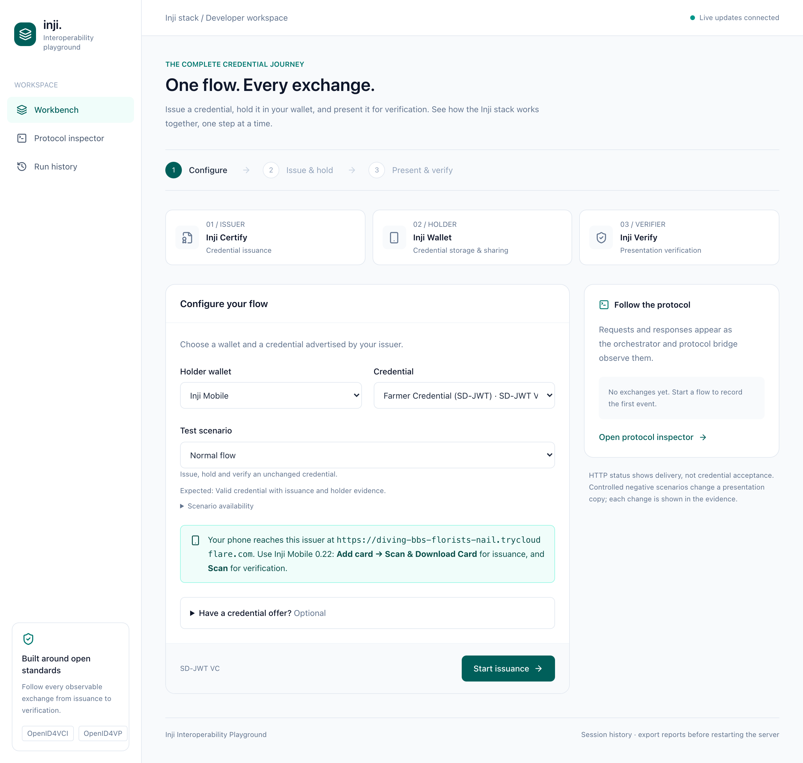
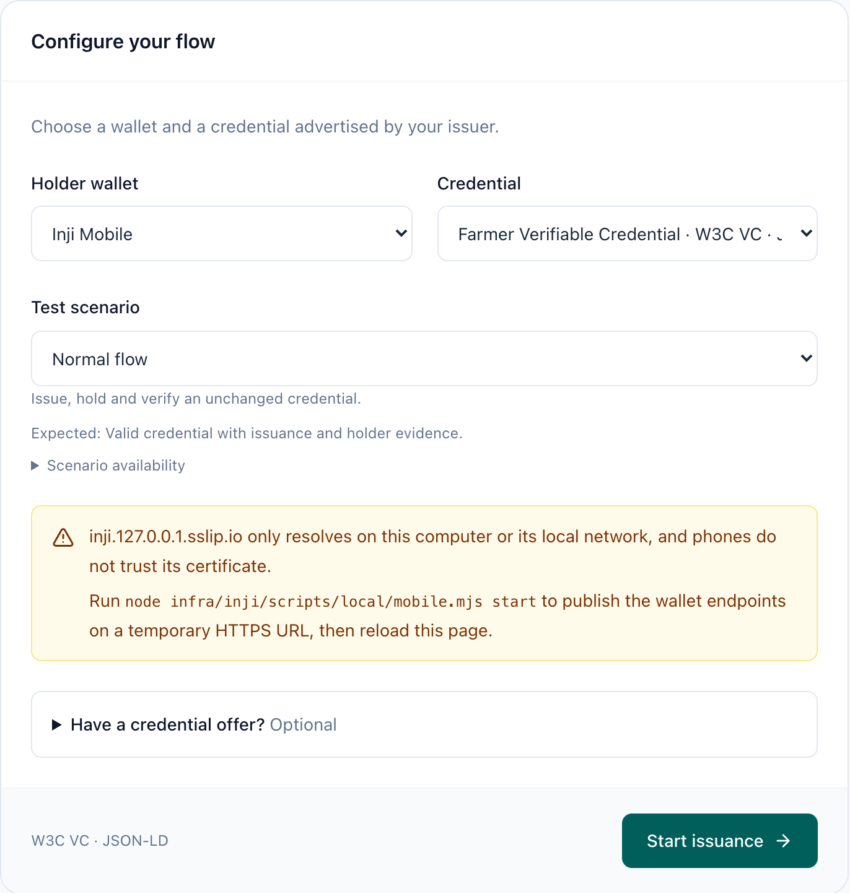
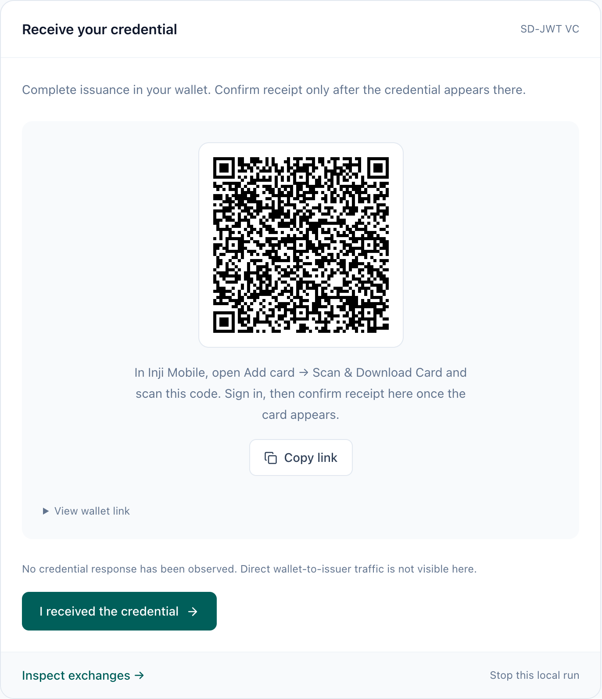
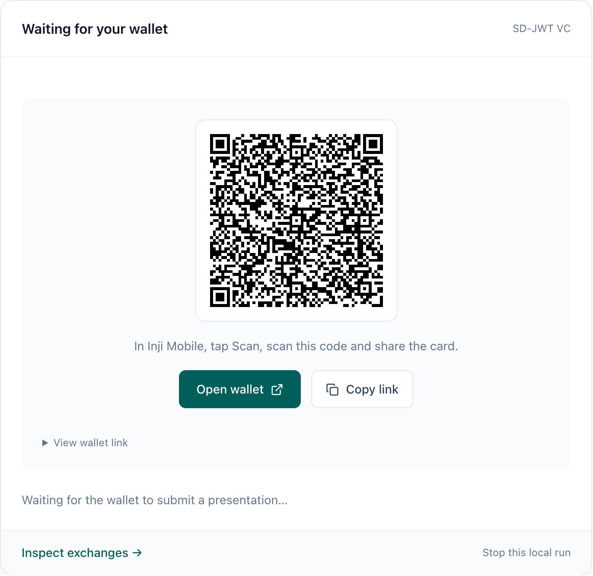
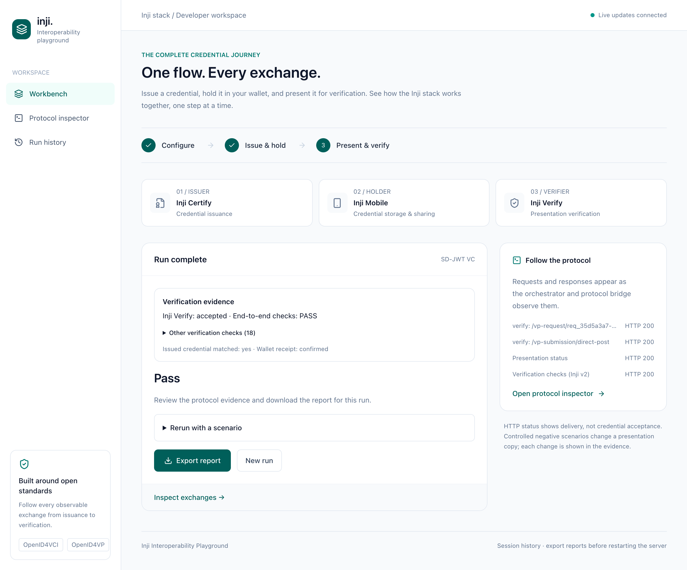
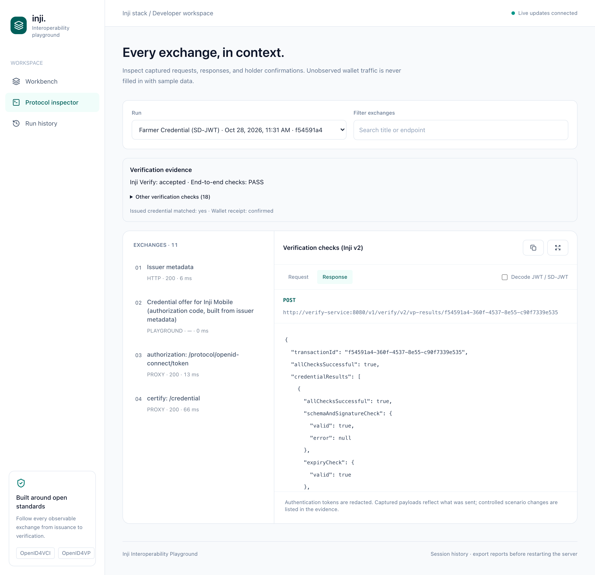

# Inji Interoperability Playground

A React workbench and Express orchestrator for Inji Certify, Inji Mobile / Web, and Inji Verify. This implementation uses configurable real services. It does not simulate credentials or verification outcomes.

## Local development

The local stack includes the client, server, Inji services and Keycloak. Open the integrated workbench at https://inji.127.0.0.1.sslip.io/playground/. The localhost entry remains http://localhost:5173, and standalone Inji Web remains https://inji.127.0.0.1.sslip.io. Follow [the local setup guide](infra/inji/README.md) for login, certificates, startup, persistence and supported flows.

For this configured workspace:

```bash
unset INJI_CONFIG_HOME
node infra/inji/scripts/prepare.mjs
docker compose -f docker-compose.yml -f docker-compose.local.yml up -d --build --wait --wait-timeout 600
```

The shared development `.env` and `infra/inji/secrets/` are committed for the private team, so a fresh clone needs only the commands above with Node.js 22 and Docker. Both frontend and backend are built and started by Compose. A new database and Keycloak realm are initialized automatically, including the embedded wallet callback. Do not run `bootstrap.mjs` on a clone; it refuses because `.env` exists. Use **Step 0 · Create account / Sign in** in the HTTPS workbench, then choose **Register** on Keycloak’s sign-in page. New accounts receive a persistent synthetic farmer record on first issuance. The optional seeded `farmer` login still uses `LOCAL_FARMER_PASSWORD` from `.env`. Accept the browser certificate warning instead of trusting `local-ca.crt` system-wide: its private key is shared.

For legacy runtime-volume installations with older secrets, follow the preservation instructions in the local setup guide before changing configuration. On this workstation the user explicitly authorized a full reset; the new direct Compose setup now uses this checkout’s `.env` and keys. The previous workspace is no longer needed.

Before the repository becomes public, remove `.env` and `infra/inji/secrets/` from history and run `node infra/inji/scripts/local/bootstrap.mjs` to create new private values. No public account or tunnel is required for the local Inji Web flow; Inji Mobile uses the optional mobile mode below.

To run client/server outside Docker, use Node.js 22.19+ in the Node 22 line, install dependencies with `npm ci` in each directory, and run `npm run dev` in both. The server reads the generated endpoints; nonempty `INJI_*` environment settings override them. Set `NODE_EXTRA_CA_CERTS` to the absolute path of `infra/inji/secrets/local-ca.crt` when calling the local HTTPS origin. Configure endpoints through files; Connections remains intentionally removed. The direct Compose workflow uses bind mounts for configuration and named volumes for mutable data. The legacy runtime-volume synchronization script remains available for environments where bind mounts do not work.

## Integrated Inji wallet

Select **Inji wallet · in this page** on the HTTPS workbench. Sign in through local Keycloak, create or unlock your wallet, and select **Authorize and receive credential**. Mimoto receives the selected credential and confirms storage automatically. Request verification, review the verifier and full-credential disclosure, and select **Approve and share credential**. The workbench displays the real Verify result. JSON-LD is supported by this pinned Mimoto release.

Existing Keycloak realms also need the additional issuance callback; realm imports do not update existing clients:

```bash
node infra/inji/scripts/local/update-wallet-client.mjs
```

Run it after Keycloak starts, using the same `INJI_CONFIG_HOME` as preparation when applicable. It adds only the workbench callback and preserves existing registrations. The normal Inji Web login still returns to its passcode page; a workbench login returns to the workbench.

See [the implementation review](context/IMPLEMENTATION_REVIEW.md) for findings, fixed gaps and remaining work, and [live validation](context/LIVE_VALIDATION.md) for evidence and limits.

## Inji Mobile on a phone

A phone cannot reach `inji.127.0.0.1.sslip.io`, and Inji Mobile only trusts publicly issued TLS certificates. **Mobile mode** publishes the wallet-facing endpoints on a temporary `*.trycloudflare.com` HTTPS URL and moves the stack's identity there (issuer and verifier `did:web`, Keycloak issuer, Verify request URLs, Mimoto trust):

```bash
node infra/inji/scripts/local/mobile.mjs start      # about a minute; prints the URL and eight readiness checks
node infra/inji/scripts/local/mobile.mjs rehearse   # optional: simulated Inji Mobile, end to end over the URL
node infra/inji/scripts/local/mobile.mjs status     # rerun the readiness checks
node infra/inji/scripts/local/mobile.mjs stop       # restore the .env origin and remove the tunnel
```

Use **Inji Mobile 0.22.x** on Android, the release paired with Certify 0.14, Mimoto 0.21 and Verify 0.17. Keep the workbench on this computer at http://localhost:5173 and choose **Inji Mobile**; the workbench confirms the phone-reachable origin.

| | |
| --- | --- |
|  |  |

1. **Start issuance.** The workbench shows a credential offer naming only this issuer and the selected credential. In the app choose **Add card → Scan & Download Card** and scan it. The app signs in through Keycloak (register an account or use `farmer`) with its public `wallet` client and PKCE, then downloads the credential. Token and credential traffic passes through the protocol bridge and appears in the inspector. Select **I received the credential** once the card is in the app.
2. **Request verification.** In the app tap **Scan**, scan the verifier QR and share the card. Inji Verify's result and the playground's independent checks appear as for any other wallet.

| Issuance | Verification | Result |
| --- | --- | --- |
|  |  |  |



Only the endpoints a phone wallet needs are public: issuer metadata and credential, DID documents, Keycloak's `inji` realm login and token, Mimoto, Verify's request and submission paths, and static configuration. The Keycloak admin console and `master` realm, the playground API and workbench, the bridge, Certify's offer creation and Verify's request creation answer 404 on the tunnel; `status` checks this. The URL is unguessable but not secret, so stop mobile mode when you are done.

Limits: each `start` gets a new URL, so credentials issued in an earlier session name an issuer DID that no longer resolves. The embedded wallet and Inji Web are unavailable while mobile mode is on. `rehearse` covers SD-JWT end to end and JSON-LD issuance plus verifier-request authentication; JSON-LD presentation needs the real app. iOS has not been tested. Use `start --origin https://…` with a stable tunnel of your own (for example an ngrok domain pointed at the gateway's `8088` listener) to keep the identity across sessions. Details are in [the local setup guide](infra/inji/README.md#inji-mobile-mode).

## Use the workbench

1. Configure Certify's upstream base URL and its canonical issuer identifier. They can differ when a protocol bridge is used, but the canonical identifier must exactly match Certify metadata.
2. Configure Inji Verify's **v1** base URL (usually ending in `/v1/verify`), its client ID, and one existing presentation definition ID per credential format (`INJI_PRESENTATION_DEFINITION_IDS`, for example `ldp_vc=<id>,vc+sd-jwt=<id>`). Each definition must request the credential in that format.
3. Discover issuer configurations on the Workbench. JSON-LD (`ldp_vc`) and SD-JWT (`vc+sd-jwt` / `dc+sd-jwt`) options appear only when advertised by Certify. The selected wallet and Verify release must also support the format.
4. Start issuance. Either paste a genuine issuer-provided credential offer or initiate the credential download inside Inji Mobile / Inji Web. Complete authentication in the wallet. No generic Certify offer-creation endpoint is assumed.
5. Confirm receipt after the credential appears in the wallet. This is recorded as **user confirmation**, not as a wallet callback or cryptographic evidence.
6. Request verification. Scan the returned QR code with Inji Mobile, or open the protocol link on a supported wallet device. For the configured Inji Web release, use **Present with Inji Web** to open its `/authorize` flow.
7. Inspect captured exchanges and export the run's JSON report from Run History. The backend collects verification results while the app is running, even after navigating away from the Workbench. Transient service failures remain visible on the run and are retried with a delay.

### Formats and wallets

The local stack advertises `FarmerCredential` (JSON-LD, Ed25519Signature2020) and `FarmerCredentialSdJwt` (`vc+sd-jwt`, ES256, selectively disclosable claims). Inji Web 0.16 / Mimoto 0.21 can store SD-JWT credentials but cannot present them over OpenID4VP; see [the validation record](context/LIVE_VALIDATION.md).

Choose **Playground mock wallet** to run SD-JWT end to end. It is a minimal OpenID4VCI / OpenID4VP holder outside the Inji stack, registered in Keycloak as the public PKCE client `playground-mock-wallet`. **Sign in and issue** opens Keycloak; after sign-in the wallet proves possession of a fresh `did:jwk` key, stores the credential and advances the run. **Present with mock wallet** discloses every claim with a Key Binding JWT. Its traffic uses public endpoints and passes through the protocol bridge. It authenticates the pinned did:web verifier's EdDSA request signature and validates its identity, endpoint, nonce, state and presentation definition before sharing. It does not support JSON-LD.

Existing environments need migrations `004` (Inji Certify database) and `005` (Inji Verify database), a Certify and Mimoto restart (Mimoto caches issuer metadata), and the realm changes in `RealmRenderer.mjs`. Fresh databases and realms receive these from initialization; migrate existing environments without deleting their volumes.

Issuer-led offer creation and onboarding APIs vary by Certify release. The current adapter supports wallet-initiated downloads and externally supplied offers; it does not automatically create an offer through Certify's administrative APIs.

## Protocol visibility

The BFF observes its own metadata / verifier API calls. It also provides a byte-preserving protocol bridge:

| Bridge prefix           | Upstream configuration   | Enabled paths                                                                                   |
| ----------------------- | ------------------------ | ----------------------------------------------------------------------------------------------- |
| `/bridge/certify`       | `INJI_CERTIFY_URL`       | `/.well-known/openid-credential-issuer`, `/credential`, `/nonce`, `/notification`               |
| `/bridge/authorization` | `INJI_AUTHORIZATION_URL` | `/token`, `/oauth/token`, `/protocol/openid-connect/token`, `/.well-known/openid-configuration` |
| `/bridge/verify`        | `INJI_VERIFY_URL`        | `/vp-request/*`, `/vp-response/*`, `/vp-submission/*`, `/presentation-definition/*`             |

Only GET and POST are forwarded. Request/response bodies are bounded at 5 MB. Authentication tokens are redacted from captured structured data. Each recorded payload is limited to 32 KB and marked when truncated; the last 300 events are retained per run. The normal flow forwards payloads unchanged. An explicitly selected signature/claim scenario mutates a presentation copy at the controlled wallet or bridge boundary and records the change. Callback URLs and redirect locations are not rewritten.

For full visibility, the connected Inji environment must already advertise bridge URLs in its metadata and callback configuration, preserving the canonical issuer and verifier trust identities. `PUBLIC_BASE_URL` displays the expected prefix; setting it alone does **not** reconfigure Inji or create network connectivity. The public URL must be reachable by the wallet. The local Compose gateway wires these routes through the bridge. Mobile mode publishes them on a phone-reachable tunnel; see [Inji Mobile on a phone](#inji-mobile-on-a-phone).

Use a dedicated development environment with one active run at a time. Token exchanges seen during that issuance session establish token-to-run correlation; `/credential` responses are associated only with a token observed by the bridge. Direct token exchanges, traffic from other wallets, encrypted payloads, and paths outside the allowlist are not fully observable. Mimoto owns the wallet login, encrypted credential storage and presentation flow.

## Outcomes and evidence

Credential validity and interoperability evidence are separate:

- **Pass** requires valid detailed Inji Verify checks, holder confirmation, a credential matching observed issuance, and independent request-binding, descriptor, format/proof/claim and submission/result correlation checks. Missing checks cannot produce a pass.
- **Valid · incomplete evidence** means Verify accepted the credential but the issuance-to-presentation match was not observed.
- **Invalid / Expired** comes from Verify's presentation and per-credential results. Request expiry is an operational error, not an expired credential verdict.
- **Error / Cancelled** never counts as a passing verification. Stopping a local run does not revoke an offer or cancel an upstream presentation request.

JSON-LD comparison uses a deterministic structural fingerprint, not a new cryptographic verification algorithm. SD-JWT comparison uses the issuer-signed JWT so selective disclosure does not break identity matching. The inspector decodes JWTs for readability only. Inji Verify supplies the credential and presentation cryptographic results. The playground separately checks request bindings, supported constraints and SD-JWT key binding; it retains any upstream acceptance even when these independent checks fail.

The adapter creates requests through the v1 API and expects `requestId`, `transactionId`, and either `requestUri` or `authorizationDetails`. Results come from `/v2/vp-results/{transactionId}`, which must return the matching `transactionId`, a boolean `allChecksSuccessful`, and exactly one `credentialResults` entry with its signature, expiry, holder-proof and status checks. An incompatible or internally inconsistent response fails explicitly. No claim of complete standards conformance is made from one successful run.

## Negative scenarios and replay

Choose **Test scenario** under flow configuration. The embedded Inji wallet supports JSON-LD scenarios; the mock wallet supports SD-JWT mutations and holder nonce control. Unsupported combinations are disabled with an explanation. The normal flow remains the default.

| Scenario | Execution and evidence |
| --- | --- |
| Bad signature / modified claim | Mutate a presentation copy; keep the wallet credential intact. JSON-LD mutations occur on the correlated bridge submission. SD-JWT mutations happen before signing its holder-binding JWT. |
| Expired credential | Certify signs the separate `FarmerCredentialExpired` configuration with dates in January 2020. No post-signing date edits. JSON-LD only. |
| Wrong type / format / proof | Create a fresh verifier request with incompatible constraints. Record wallet matching rejection separately from verifier rejection. The diagnostic mock wallet deliberately submits its credential even when constraints do not match, to exercise verifier enforcement. A verifier rejection passes when the playground's matching constraint check fails, every other binding and Inji Verify check passes, and the issued credential is confirmed not to satisfy the request. |
| Unsupported DID | Certify signs the separate `FarmerCredentialUnsupportedDid` fixture with `did:playground:unresolvable-issuer` before signing. Report the actual rejection/failure stage, including storage failures. JSON-LD only. |
| Wrong nonce | The mock wallet signs its SD-JWT key-binding JWT with a deliberately different nonce. Unexpected acceptance is a scenario failure and remains visible. A rejection passes when the playground's nonce check confirms the wrong nonce was sent, the issuer signature is valid and all other bindings pass. |
| QR limit | Apply the same QR byte policy used by the handoff component to an oversized local sample. This is a workbench fallback check, not a physical-scanner capacity test or a verifier rejection. |

The result card and inspector show expected behavior, actual stage, verdict and before/after changes. A generic `INVALID` result confirms rejection but does not prove the precise cryptographic reason. Changing a VC inside a signed JSON-LD VP can invalidate both proofs. An HTTP error or service outage never automatically passes a negative scenario.

Report version 3 separates `scenarioResult` from `verdict` and `interoperabilityOutcome`. For negative scenarios, top-level `outcome` is the scenario assessment: `PASS`, `FAIL`, `INCONCLUSIVE`, `PENDING`, or `CANCELLED`. Correct rejection can therefore pass the scenario while the credential remains invalid. The expiry scenario requires a matching issued credential, valid issuer and holder signatures, a failed expiry check and intact request bindings. Signature scenarios require the expected detailed signature error and correlated evidence; claim mutations also use independent original/modified credential controls. No credential-status entry is labelled `NOT_APPLICABLE`, not a successful revocation check. History supports scenario and outcome filters.

**Replay with a scenario** on a finished run starts a linked run (`parentRunId`) with fresh issuance and a new verifier request. It does not reuse an old `vp_token` or transfer wallet keys between sessions. The original evidence remains available until the in-memory history is evicted or the server restarts.

Fresh local installations include the signed fixtures and Keycloak scopes through the configuration renderer. To upgrade an existing local stack without resetting its data:

```bash
node infra/inji/scripts/local/enable-negative-scenarios.mjs
docker compose -f docker-compose.yml -f docker-compose.local.yml restart certify mimoto-service
docker compose -f docker-compose.yml -f docker-compose.local.yml up -d --build --no-deps playground-server playground-client
```

The helper only adds fixture configurations/scopes and changes the normal JSON-LD scope from default to optional. Wallets already request the selected credential scope explicitly. This avoids this Certify release stopping at an unrelated default credential scope. Sign in again after restarting Mimoto. Local service configuration and existing credentials are preserved.

## Code organization

- `server/models`: DTOs, adapter/repository contracts, and the in-memory run DAO.
- `server/services`: workflow services, Inji adapters, HTTP transport, protocol proxy and telemetry, grouped by feature.
- `server/controllers`: HTTP route translation. `server/app.ts` is the composition root; `server/index.ts` starts the listener.
- `client/src/models`: shared DTO type exports. DTO imports are type-only. The browser also shares the pure scenario catalog, outcome evaluator and QR policy from `server/models/scenarios.ts`; these have no Node or service dependencies.
- `client/src/api` and `services`: typed API transport, query hooks, WebSocket lifecycle, formatting and payload inspection.
- `client/src/pages` and `components`: routed views and focused feature components. Zustand holds selection state; TanStack Query owns server data.

Services receive their dependencies through constructors, keeping protocol implementations, storage and transport replaceable. React components remain functional. Feature groups exceeding three files use their own directories. No dependency-injection container or external-stack implementation is needed.

History is intentionally in memory: up to 100 runs per server session. Service endpoints are loaded from project configuration at startup. Export reports before restart. Server unit tests live in `server/tests` and run with `npm test` (Node's built-in runner through `tsx`); they cover redaction, fingerprints, run storage, the mock wallet's request authentication and SD-JWT binding, bridge path rules and scenario scoring. Infrastructure script tests (configuration rendering, mobile mode) run with `node --test "infra/inji/scripts/tests/*.test.mjs"`. Other checks are `npm run typecheck` / `npm run build` in `server` and `npm run lint` / `npm run build` in `client`. GitHub Actions (`.github/workflows/ci.yml`) runs all of them on pushes to `main` and on pull requests, and the server Docker image build also runs the tests. Frontend API mutations do not automatically retry.

## Reference contracts

- [Inji Certify overview and supported capabilities](https://docs.inji.io/inji-certify/overview)
- [Inji Verify cross-device workflow](https://docs.inji.io/inji-verify/functional-overview/workflow/openid4vp-cross-device-flow)
- [Inji Verify integration guide](https://docs.inji.io/inji-verify/technical-overview/integration-guides/openid4vp-vp-verification-integration-guide)
- [Inji Mobile credential-offer release notes](https://docs.inji.io/inji-wallet/inji-mobile/versions/version-0.18.0)

The Verify v1 request/status/result shapes were also checked against the existing SDK 0.16.0 package supplied with the boilerplate. That package bundles React 18 internals, so the React 19 client uses its documented HTTP contracts through a dedicated adapter instead of mounting an incompatible widget.
