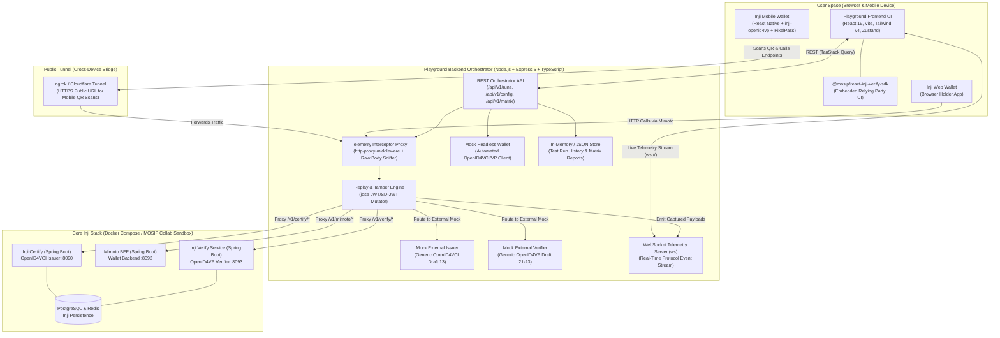
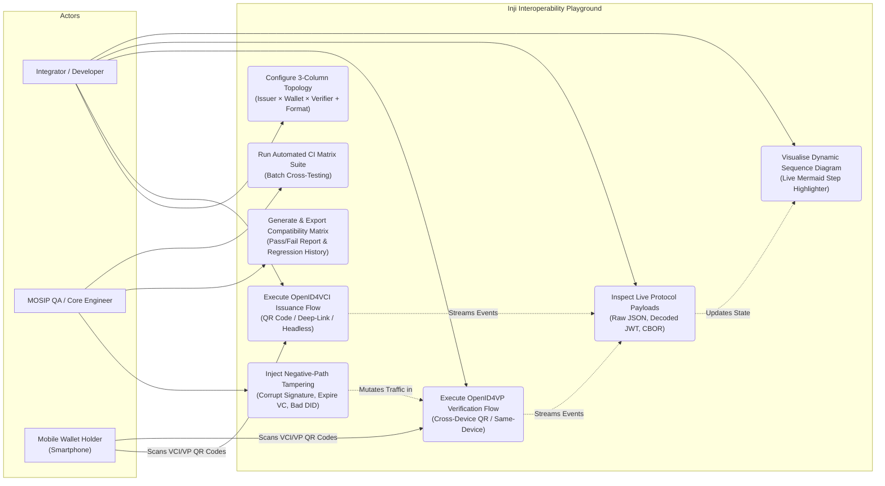
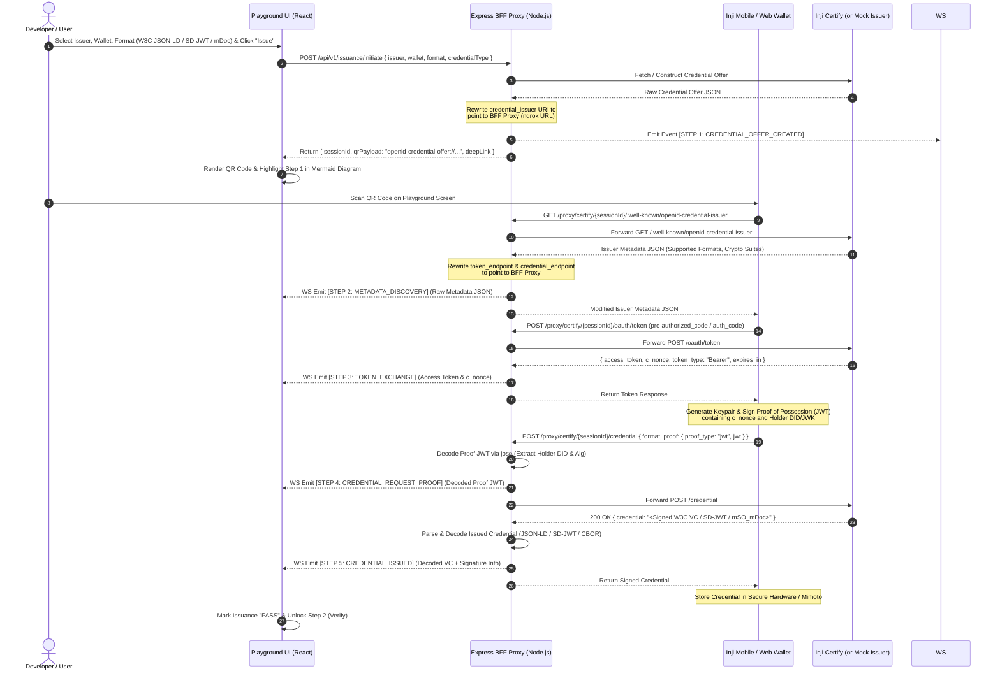
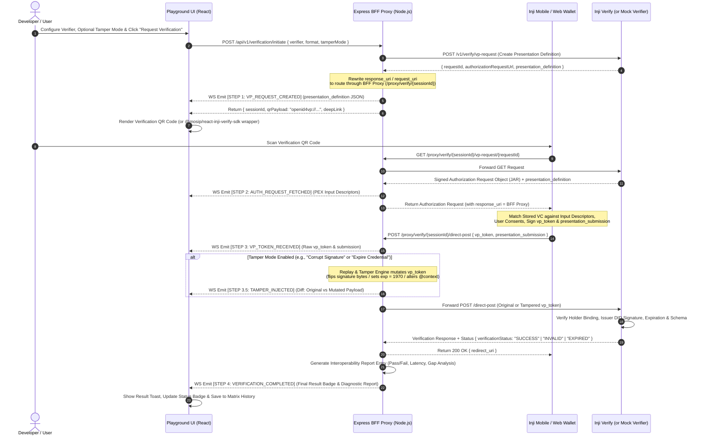

# Inji Interoperability Playground — System Architecture & Technical Blueprint

## 1. Executive Summary & Architectural Vision

The **Inji Interoperability Playground** is a visual, "Postman-style" protocol test bench and verification sandbox designed for the MOSIP Verifiable Credential (VC) ecosystem. Its primary engineering goal is to prove two-way standards compliance across **Inji Certify** (Issuer), **Inji Wallet / Inji Web** (Holders), and **Inji Verify** (Verifier), while cross-testing them against external, standards-compliant **OpenID4VCI (Draft 13)** and **OpenID4VP (Draft 21–23)** implementations (e.g., Walt.id / Sphereon mocks).

### The Core Architectural Challenge: "The Blind Browser Problem"
In standard Verifiable Credential flows involving a mobile wallet:
1. The Playground Web UI displays a QR Code (`openid-credential-offer://...` or `openid4vp://...`).
2. The user scans the QR code using the **Inji Mobile Wallet** on their smartphone.
3. The smartphone communicates **directly** over HTTP with the Issuer (Inji Certify) or Verifier (Inji Verify).

If the smartphone talks directly to the Inji Docker containers or Collab Sandbox, **the Playground Web UI is completely blind to the network handshake** (it cannot see the `/token` exchange, Proof of Possession JWT, `/credential` response, or `vp_token` submission).

### Our Solution: The BFF "Telemetry Interceptor Proxy" Pattern
To solve this without modifying the core Java source code of Inji Certify, Mimoto, or Inji Verify, our **Node.js + Express 5 Backend-for-Frontend (BFF)** acts as a **Reverse-Proxy Telemetry Interceptor (Man-in-the-Middle for Testing)**:
* Every QR code and deep-link generated by the Playground rewrites the target `credential_issuer` or `response_uri` host to point to our **Express BFF URL** (exposed via `ngrok` for mobile cross-device testing, or `localhost:4000` for same-device/web flows).
* When Inji Wallet or Inji Web hits the Express BFF, our custom middleware intercepts the raw HTTP request/response streams, decodes JWT/SD-JWT/CBOR payloads using `jose` and `@injistack/pixelpass`, optionally applies **"Replay & Tamper" mutations**, emits real-time telemetry events over **WebSockets (`ws`)** to the React 19 UI, and transparently forwards the request to the upstream Inji service or internal Mock Engine.

---

## 2. High-Level System Architecture



---

## 3. Use Case Diagram

The following diagram illustrates all actor interactions across the Mandatory, Good-to-Have, and Bonus tasks outlined in the FRD.



---

## 4. End-to-End Protocol Sequence Diagrams

### 4.1 Flow 1: OpenID4VCI (Draft 13) Credential Issuance via Interceptor Proxy
This flow shows how the Express BFF intercepts every step between **Inji Wallet** and **Inji Certify** (or the Mock External Issuer) so the React UI can render the live handshake.



---

### 4.2 Flow 2: OpenID4VP (Draft 21–23) Presentation, Tamper Mode & Verification
This flow demonstrates how the Playground coordinates **Presentation Exchange (PEX)**, intercepts the `vp_token` from the wallet, applies optional **Replay & Tamper** rules, and validates the response via **Inji Verify**.



---

## 5. Integration Strategy: Inji Stack, Mocks & Dependencies

### 5.1 How the Core Inji Modules Are Integrated
To ensure our playground works seamlessly both in a **local Docker Compose setup** and against the **MOSIP Collab Sandbox** (fastest path during development/demos), the Express BFF uses an **Environment-Driven Adapter Pattern**:

| Module Role | Implementation Option | Integration Mechanism in Playground |
| :--- | :--- | :--- |
| **Issuer 1 (Inji)** | **Inji Certify** (`mosip/inji-certify`) | Connected via Docker Compose (`http://inji-certify:8090`) or Collab Sandbox URL (`https://certify.collab.mosip.net`). Supports Mock ID plugin for W3C JSON-LD (`Ed25519Signature2020`, `RsaSignature2018`), IETF `vc+sd-jwt`, and `mso_mdoc`. |
| **Issuer 2 (External)** | **Walt.id / Generic OpenID4VCI Mock** | Built natively into our Express BFF (`/mock/issuer/vci/*`) using `jose` and `@injistack/pixelpass`. Issues strict RFC/Draft-13 compliant SD-JWT and W3C VCs using `did:jwk` or `did:web` to test if Inji Wallet can ingest external non-MOSIP credentials. |
| **Wallet 1 (Inji Mobile)** | **Inji Wallet Mobile** (iOS / Android) | Connects cross-device by scanning QR codes rendered by `qrcode.react` (routed through `ngrok` tunnel to Express BFF) or Same-Device via `openid4vp://` and `openid-credential-offer://` deep links. |
| **Wallet 2 (Inji Web)** | **Inji Web + Mimoto BFF** | Connected via Mimoto proxy (`http://mimoto:8092` or Collab Sandbox) and deep-linked via browser window orchestration. |
| **Wallet 3 (External Mock)** | **Simulated Spec-Compliant Wallet** | Built into our Express BFF (`MockWalletService`). Allows a developer without a physical phone to click **"Run Full Automated Flow"** in the browser—performing the exact OpenID4VCI and OpenID4VP cryptographic handshakes over HTTP so every step still populates the Protocol Inspector! |
| **Verifier 1 (Inji)** | **Inji Verify Service + SDK** | Dual integration: Uses `@mosip/react-inji-verify-sdk` (`QRCodeVerification` / `OpenID4VPVerification`) in the React UI and proxies backend OpenID4VP calls to `inji-verify-service` (`:8093`). |
| **Verifier 2 (External)** | **Sphereon / Generic OpenID4VP Mock** | Built into our Express BFF (`/mock/verifier/vp/*`). Constructs DIF Presentation Exchange v2.0 requests (`presentation_definition`) and validates incoming `vp_token` payloads from Inji Wallet using `jose` to prove cross-ecosystem presentation. |

### 5.2 Handling the React 19 + `@mosip/react-inji-verify-sdk` Integration
Because `@mosip/react-inji-verify-sdk` was built targeting React 18 peer dependencies, we isolate it inside an **ErrorBoundary + Adapter Wrapper Component** (`<InjiVerifySdkBridge />`) on the client. This gives the user a toggle inside the Verifier panel:
* **Mode A: Proxy-Intercepted OpenID4VP Flow (Default)** — Renders our custom high-visibility QR code and deep-link controls routed through the Express Telemetry Interceptor so 100% of raw payloads (`presentation_definition`, `vp_token`, `presentation_submission`) are captured.
* **Mode B: Native Embedded `@mosip/react-inji-verify-sdk` Widget** — Mounts the official MOSIP `OpenID4VPVerification` / `QRCodeVerification` React component directly inside a dedicated modal/tab to demonstrate drop-in SDK compatibility.

---

## 6. UI/UX Architecture: Preventing Information Overload

A common pitfall in developer playgrounds is dumping 5 JSON editors, 3 configuration forms, a Mermaid diagram, QR codes, and a test matrix onto a single scrolling screen. 

To make the UI **intuitive, scannable, and clutter-free**, we will use **Progressive Disclosure**, **Contextual Modals (`@radix-ui/react-dialog`)**, and a **Split-Pane Workbench Layout** inspired by Linear, Postman, and Stripe's API Workbench.

### 6.1 Information Hierarchy & Layout Blueprint

```
+--------------------------------------------------------------------------------------------------+
|  HEADER BAR: [Inji Interop Logo]   [Env: Collab / Local Docker]   [Ngrok Status]                 |
|              Nav Tabs: [ 1. Live Workbench ]   [ 2. Compatibility Matrix (14) ]   [ 3. Diagnostics ]|
+--------------------------------------------------------------------------------------------------+
|  COMPACT TOPOLOGY RIBBON (Collapsible after run starts)                                          |
|  +-------------------------+   +-------------------------+   +-------------------------+         |
|  | 1. ISSUER               |   | 2. HOLDER WALLET        |   | 3. VERIFIER             |         |
|  | [Inji Certify      v]   |-->| [Inji Mobile (QR)  v]   |-->| [Inji Verify       v]   |         |
|  | Format: [SD-JWT VC v]   |   | Mode: [Cross-Device]    |   | Tamper: [OFF (Valid) v] |         |
|  +-------------------------+   +-------------------------+   +-------------------------+         |
|  [ ▶ Run Issuance (Step 1) ]   [ ▶ Run Verification (Step 2) ]   [ ⚡ Auto-Run Full Cycle ]      |
+-----------------------------------------------+--------------------------------------------------+
|  LEFT PANE (42% Width):                       |  RIGHT PANE (58% Width):                         |
|  ACTIVE STAGE & VISUAL TIMELINE               |  LIVE PROTOCOL INSPECTOR (Tabbed Drawer)         |
|                                               |                                                  |
|  +-----------------------------------------+  |  [ Sequence Diagram ] [ Payload JSON ] [ Crypto ]|
|  | CURRENT ACTION CARD                     |  |  +--------------------------------------------+  |
|  | [ Status Pill: Waiting for Wallet Scan ]|  |  | Step 1: Credential Offer Created     24ms  |  |
|  |                                         |  |  | Step 2: .well-known Metadata         18ms  |  |
|  |         +-------------------+           |  |  | Step 3: OAuth2 /token Exchange       42ms  |  |
|  |         |  [ QR CODE HERE ] |           |  |  | Step 4: Proof JWT Verified           15ms  |  |
|  |         +-------------------+           |  |  | Step 5: VC Issued (vc+sd-jwt)        61ms  |  |
|  |                                         |  |  +--------------------------------------------+  |
|  | [ Copy Deep-Link ] [ Simulate Scan 🤖 ] |  |  | SELECTED STEP: Step 5 - VC Issued          |  |
|  +-----------------------------------------+  |  | [ Raw Wire ] [ Decoded Claims ] [ Headers ]|  |
|                                               |  | {                                          |  |
|  +-----------------------------------------+  |  |   "vct": "IdentityCredential",             |  |
|  | STEP-BY-STEP PROGRESS                   |  |  |   "iss": "did:web:certify.mosip.net",      |  |
|  | (✓) 1. Offer Generated                  |  |  |   "_sd": ["9f86d081884c7d659a2feaa0c55..."]|  |
|  | (✓) 2. Metadata Discovered              |  |  | }                                          |  |
|  | (●) 3. Awaiting Token Exchange...       |  |  | [ 🔍 Expand Fullscreen Modal ]             |  |
|  +-----------------------------------------+  |  +--------------------------------------------+  |
+-----------------------------------------------+--------------------------------------------------+
|  STICKY FOOTER BANNER: [ Run Outcome: PASS ✅ | Format: SD-JWT | Proof: Ed25519 | View Report ↗ ]|
+--------------------------------------------------------------------------------------------------+
```

### 6.2 How We Use Popups, Drawers, and Progressive Disclosure

1. **Compact Topology Ribbon (Top):**
   * Instead of huge configuration cards taking up half the screen, the 3-column **Issuer $\rightarrow$ Wallet $\rightarrow$ Verifier** selector sits in a sleek top ribbon.
   * Advanced cryptographic settings (DID method `did:web` vs `did:jwk`, Proof Suite `Ed25519Signature2020` vs `RS256`, custom claims) are tucked inside a **"⚙️ Configure Parameters" Radix Dialog Modal** so the main canvas stays clean.
2. **Contextual QR & Action Modal / Card (Left Pane):**
   * Only the **currently active step's UI** is displayed in the Left Pane. When issuing, it shows the OpenID4VCI QR Code, a PixelPass compression size indicator (e.g., `1.4 KB / 2.9 KB QR Limit`), a deep-link button for same-device testing, and a **"🤖 Simulate Mobile Scan"** button (so judges/evaluators can test the entire flow in 1 click even without configuring `ngrok` or installing the phone app!).
3. **Tabbed Protocol Inspector (Right Pane):**
   * Rather than stacking Mermaid diagrams and multiple JSON blobs vertically, the Right Pane uses clean tabs:
     * **Tab 1: Live Sequence Diagram (`mermaid`)** — Dynamically highlights the active arrow in green (or red on failure) as WebSocket events arrive. Clicking any step in the timeline opens its payload.
     * **Tab 2: Wire Payload Inspector** — Shows a clickable vertical step list on the left and a syntax-highlighted JSON viewer on the right with sub-tabs for **Raw Wire Payload**, **Decoded JWT / SD-JWT Disclosures / CBOR Claims**, and **HTTP Headers**.
     * **Tab 3: Cryptographic & Tamper Diff** — When "Replay & Tamper" mode is active, displays a clean side-by-side **Original vs. Tampered JSON diff** alert box explaining *why* Inji Verify rejected the presentation.
4. **Radix Dialog Popups (`@radix-ui/react-dialog`) for Deep Dives:**
   * **Fullscreen Payload Inspector Modal:** Clicking "Expand" on any JSON payload opens a spacious modal with search, copy-to-clipboard, and JWT header/payload/signature color-coding (like `jwt.io`).
   * **Interoperability Run Report Modal:** When a run finishes (Pass, Fail, or Valid-but-Expired), a toast notification pops up with a **"View Diagnostic Report"** button. Clicking it opens a clean modal showing the exact pass/fail matrix breakdown, any detected interoperability gap (e.g., *"DID Method `did:key` unsupported by Verifier"*), and a 1-click **"Generate GitHub Issue Markdown"** button!

---

## 7. Backend (Server) Architecture & API Specification

### 7.1 Server Directory Structure (`server/`)
```text
server/
├── src/
│   ├── index.ts                    # Express 5 + HTTP + WebSocket Server entry point
│   ├── config/
│   │   └── env.ts                  # Upstream URLs (Inji Certify, Verify, Mimoto, Ngrok URL)
│   ├── ws/
│   │   └── telemetrySocket.ts      # WebSocket broadcast manager for live protocol steps
│   ├── proxy/
│   │   ├── certifyProxy.ts         # Intercepts OpenID4VCI calls (/.well-known, /token, /credential)
│   │   └── verifyProxy.ts          # Intercepts OpenID4VP calls (/vp-request, /direct-post)
│   ├── services/
│   │   ├── cryptoInspector.ts      # Uses `jose` & `@injistack/pixelpass` to decode JWT/SD-JWT/CBOR
│   │   ├── tamperEngine.ts         # Mutates VCs/VPs (bad signature, expired exp, wrong type)
│   │   ├── mockIssuerService.ts    # Built-in external OpenID4VCI (Draft 13) compliant issuer
│   │   ├── mockWalletService.ts    # Built-in automated holder wallet for 1-click browser flows
│   │   ├── mockVerifierService.ts  # Built-in external OpenID4VP (Draft 21-23) relying party
│   │   └── matrixStore.ts          # Persists test runs, pass/fail reports & detected interop gaps
│   └── routes/
│       ├── issuance.routes.ts      # /api/v1/issuance/*
│       ├── verification.routes.ts  # /api/v1/verification/*
│       ├── matrix.routes.ts        # /api/v1/matrix/*
│       └── mockProtocol.routes.ts  # /oid4vci/* and /oid4vp/* endpoints for mobile/external calls
├── package.json
└── tsconfig.json
```

### 7.2 REST API Endpoints (`http://localhost:4000`)

#### A. Playground Orchestration & Configuration
| Method | Endpoint | Description |
| :--- | :--- | :--- |
| `GET` | `/api/v1/health` | Returns status of Express BFF, connected WebSocket clients, and reachability of upstream Inji Certify, Mimoto, and Inji Verify services. |
| `GET` | `/api/v1/config/topology` | Returns available Issuers, Wallets, Verifiers, Credential Formats (`ldp_vc`, `vc+sd-jwt`, `mso_mdoc`), Proof Types, and Tamper Modes. |
| `POST` | `/api/v1/config/environment` | Updates target URLs (e.g., switching between MOSIP Collab Sandbox, Local Docker Compose, and updating the public `ngrok` tunnel URL). |

#### B. OpenID4VCI Issuance Flow Endpoints
| Method | Endpoint | Description |
| :--- | :--- | :--- |
| `POST` | `/api/v1/issuance/initiate` | Starts a new issuance test session. Generates an OpenID4VCI `credential_offer` (from Inji Certify or Mock Issuer), encodes QR data with `@injistack/pixelpass`, and emits Step 1 to WebSocket. |
| `POST` | `/api/v1/issuance/:sessionId/simulate-wallet` | Triggers the server's `mockWalletService` (or Mimoto proxy) to execute the full OpenID4VCI discovery $\rightarrow$ token $\rightarrow$ proof JWT $\rightarrow$ credential download handshake against the active issuer. |

#### C. OpenID4VP Verification & Tamper Flow Endpoints
| Method | Endpoint | Description |
| :--- | :--- | :--- |
| `POST` | `/api/v1/verification/initiate` | Starts an OpenID4VP presentation request (`presentation_definition`). Configures optional `tamperMode` (`NONE`, `EXPIRED_VC`, `INVALID_SIGNATURE`, `WRONG_CREDENTIAL_TYPE`, `UNSUPPORTED_DID`). |
| `POST` | `/api/v1/verification/:sessionId/simulate-presentation` | Triggers the holder wallet to construct a `vp_token` and `presentation_submission`, passes it through the Tamper Engine if enabled, and submits it to Inji Verify or the Mock Verifier. |

#### D. Proxy & Protocol Interception Endpoints (Called by Mobile/Web Wallets)
| Method | Endpoint | Description |
| :--- | :--- | :--- |
| `GET` | `/oid4vci/:sessionId/.well-known/openid-credential-issuer` | Intercepts metadata discovery, logs supported formats/algorithms to UI, and rewrites endpoints to keep the wallet routed through the BFF proxy. |
| `POST` | `/oid4vci/:sessionId/token` | Intercepts OAuth 2.0 token request (`pre-authorized_code`), captures `access_token` and `c_nonce`, emits to UI, and returns to wallet. |
| `POST` | `/oid4vci/:sessionId/credential` | Intercepts Credential Request, decodes the Holder's Proof of Possession JWT via `jose`, fetches or signs the requested VC (`JSON-LD`, `SD-JWT`, or `mso_mdoc`), and streams the issued credential to the UI. |
| `GET` | `/oid4vp/:sessionId/request-object` | Serves the OpenID4VP Authorization Request (`presentation_definition` + `nonce` + `response_uri`) to scanning wallets and logs the event to the UI. |
| `POST` | `/oid4vp/:sessionId/response` | Receives `vp_token` and `presentation_submission` (`direct_post`), applies Tamper Engine rules if active, validates via Inji Verify / Mock Verifier, and emits the final Pass/Fail verification verdict. |

#### E. Interoperability Matrix & Regression History Endpoints
| Method | Endpoint | Description |
| :--- | :--- | :--- |
| `GET` | `/api/v1/matrix/runs` | Returns historical test runs with filters for `issuer`, `wallet`, `verifier`, `format`, and `outcome` (`PASS`, `FAIL`, `VALID_EXPIRED`). |
| `POST` | `/api/v1/matrix/batch-run` | Automated CI test runner (Bonus Task) that executes a matrix of combinations sequentially and streams live progress to the UI. |
| `GET` | `/api/v1/matrix/export` | Exports the full Interoperability Matrix & Discovered Gaps report as clean Markdown (`INTEROP_REPORT.md`) or JSON. |

---

## 8. Frontend (Client) Architecture & State Management

### 8.1 Client Directory Structure (`client/src/`)
```text
client/src/
├── main.tsx
├── App.tsx                             # Router & Global Providers (TanStack Query, WebSocket Listener)
├── store/
│   └── usePlaygroundStore.ts           # Zustand store for active topology, live protocol steps & UI modals
├── services/
│   ├── api.ts                          # Typed fetch client for Express BFF endpoints
│   └── wsClient.ts                     # WebSocket hook that pushes live server telemetry into Zustand
├── types/
│   └── playground.types.ts             # Shared interfaces for Topology, ProtocolEvent, TestRun, TamperMode
├── components/
│   ├── layout/
│   │   ├── HeaderBar.tsx               # Navigation tabs, Environment badge, Ngrok tunnel config button
│   │   └── StatusBanner.tsx            # Sticky footer showing current run status & quick report trigger
│   ├── workbench/
│   │   ├── TopologyRibbon.tsx          # 3-Column Issuer -> Wallet -> Verifier selector + Format/Tamper pills
│   │   ├── ActiveWorkflowStage.tsx     # Left Pane: Dynamic QR code (`qrcode.react`), deep-links, step checklist
│   │   ├── ProtocolInspectorPanel.tsx  # Right Pane: Tabbed container for Mermaid, JSON payloads & Crypto Diff
│   │   ├── LiveMermaidDiagram.tsx      # Renders animated Mermaid sequence diagram synced to active step
│   │   └── InjiVerifySdkBridge.tsx     # Isolates `@mosip/react-inji-verify-sdk` components in a clean view
│   ├── modals/                         # Built with `@radix-ui/react-dialog` to prevent page clutter
│   │   ├── PayloadFullScreenModal.tsx  # Deep-dive JWT/SD-JWT/CBOR decoder & raw JSON inspector
│   │   ├── AdvancedConfigModal.tsx     # Configure Ngrok URL, Collab endpoints, DID methods & key types
│   │   ├── RunDiagnosticModal.tsx      # Detailed Pass/Fail report & GitHub Issue generator for a run
│   │   └── TamperConfigModal.tsx       # Visual selector for negative-path testing ("Replay & Tamper")
│   └── matrix/
│       ├── CompatibilityMatrixView.tsx # Cross-ecosystem heatmap grid (Issuer × Wallet × Verifier × Format)
│       └── GapAnalysisView.tsx         # Pre-populated + live-detected interoperability gaps & bug reports
```

### 8.2 Zustand State Store Design (`usePlaygroundStore.ts`)
Using `zustand`, we keep the UI hyper-responsive without prop-drilling:
* **`topology`**: `{ issuer, wallet, verifier, credentialFormat, proofType, flowMode, tamperMode }`
* **`activeSession`**: `{ sessionId, phase: 'IDLE' | 'ISSUING' | 'HELD' | 'VERIFYING' | 'COMPLETED', qrCodeUri, deepLinkUri, issuedCredential, verificationStatus }`
* **`protocolEvents`**: `ProtocolEvent[]` — Appended in real time via WebSocket. Each event contains `{ id, timestamp, phase, stepNumber, title, actorFrom, actorTo, httpMethod, endpoint, rawPayload, decodedPayload, tamperDiff, status, latencyMs }`.
* **`selectedEventId`**: Controls which step is currently inspected in the Right Pane or Fullscreen Modal.

---

## 9. Multi-Format Credential & Cryptographic Coverage

To satisfy Mandatory Task #6 and Good-to-Have Task #2, our playground explicitly labels, issues, inspects, and verifies all three credential standards used across MOSIP Inji:

| Credential Format | Standard Identifier | Proof / Signature Scheme | How the Playground Inspects & Visualizes It |
| :--- | :--- | :--- | :--- |
| **W3C VC Data Model 1.1 / 2.0** | `ldp_vc` / `jwt_vc_json-ld` | `Ed25519Signature2020`, `RsaSignature2018` | Displays `@context`, `credentialSubject`, `issuer` DID, and separates the cryptographic `proof` block (`proofValue`, `verificationMethod`). |
| **IETF SD-JWT VC** | `vc+sd-jwt` | JOSE `EdDSA` / `ES256` + SHA-256 Salted Disclosures (`~`) | Splits the raw `<Issuer-Signed JWT>~<Disclosure 1>~<Disclosure 2>~<KB-JWT>` string by `~`, decodes each Base64URL disclosure array `[salt, claimName, claimValue]`, and shows which claims are selectively disclosed vs. blinded (`_sd` digests)! |
| **ISO/IEC 18013-5 (mDoc / mDL)** | `mso_mdoc` | COSE_Sign1 (`ES256`) + CBOR Tag 24 (`IssuerSignedItem`) | Decodes the Base64URL/Hex CBOR structure into human-readable JSON namespaces (`org.iso.18013.5.1`), displaying `docType`, `validityInfo`, and `valueDigests` inside the Protocol Inspector. |

---

## 10. Step-by-Step Implementation Plan

### Phase 1: Backend BFF Core, Cryptographic Engines & WebSocket Telemetry
1. Configure `server/src/index.ts` with Express 5, CORS, JSON body parsing, and a unified `ws` WebSocket server attached to the HTTP server.
2. Build `cryptoInspector.ts` and `tamperEngine.ts` using `jose` and `@injistack/pixelpass` to generate and decode W3C JSON-LD VCs, SD-JWT VCs (with salted disclosures), and mock `mso_mdoc` payloads, plus QR payload compression.
3. Implement the OpenID4VCI (`/oid4vci/*`) and OpenID4VP (`/oid4vp/*`) proxy/mock endpoints that emit structured `ProtocolEvent` packets over WebSockets on every handshake step.
4. Implement the automated CI Matrix Runner (`/api/v1/matrix/batch-run`) and pre-seed realistic interoperability gap findings alongside live test execution.

### Phase 2: Frontend State, WebSocket Hook & Workbench Layout
1. Set up the Zustand store (`usePlaygroundStore.ts`) and TanStack Query provider in `client/src/`.
2. Build the `HeaderBar` (with navigation between **Live Workbench**, **Compatibility Matrix**, and **Interop Gaps & Diagnostics**) and the **3-Column `TopologyRibbon`**.
3. Build the Left Pane (`ActiveWorkflowStage`) featuring dynamic QR rendering (`qrcode.react`), PixelPass payload density metrics, deep-link buttons, and the 1-click **"Simulate Wallet Scan"** trigger.

### Phase 3: Live Protocol Inspector, Mermaid Sequence Visualizer & Modals
1. Build the Right Pane (`ProtocolInspectorPanel`) with live WebSocket event streaming, step latency badges, and decoded SD-JWT / JSON-LD / mDoc views.
2. Integrate `mermaid` (`LiveMermaidDiagram.tsx`) to dynamically re-render and highlight the active protocol exchange step in real time.
3. Build the Radix UI Dialog modals (`@radix-ui/react-dialog`) for **Fullscreen Payload Inspection**, **Replay & Tamper Configuration**, **Embedded `@mosip/react-inji-verify-sdk` Modal**, and **Diagnostic Run Reports**.

### Phase 4: Docker Compose Bundle & Documentation
1. Provide a unified `docker-compose.yml` at the project root that spins up the Playground Client, Playground Express BFF, and connects to Inji Certify / Verify / Mimoto (or MOSIP Collab Sandbox out-of-the-box).