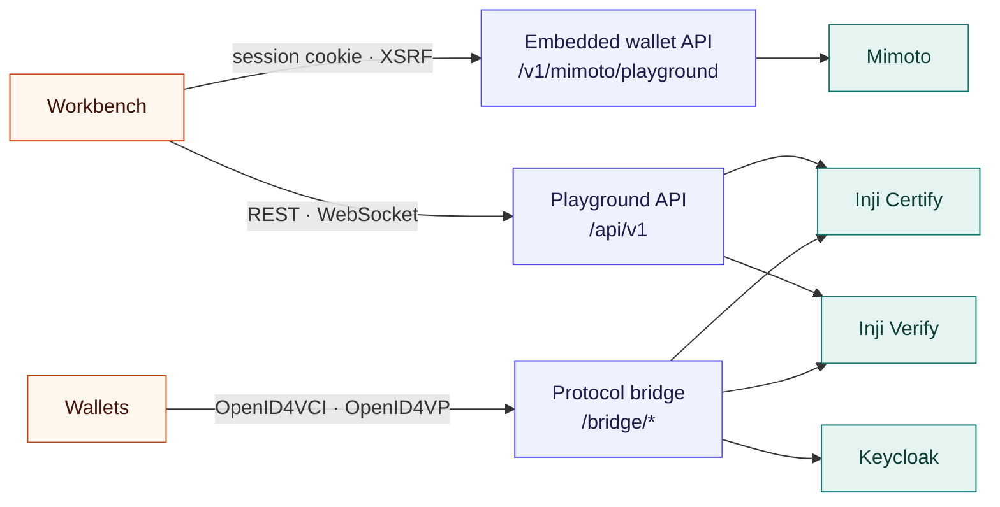

# API documentation

Every API the playground exposes, and every upstream API it calls. The examples are real responses from the local stack, shortened where marked with `…`.



## Conventions

| | |
| --- | --- |
| **Base URLs** | `http://localhost:8000` directly; `http://localhost:5173` and `https://inji.127.0.0.1.sslip.io` through the client and gateway. All are bound to `127.0.0.1`. |
| **Format** | JSON. `POST` requests to `/api/*` must send `Content-Type: application/json`, with a body of at most 256 KB. |
| **Errors** | `{"error": "message"}` with an HTTP status. Unexpected failures return 500 with `Unexpected server error.` and are logged on the server. |
| **Caching** | Every response sends `Cache-Control: no-store`. |

### Authentication

| API | Authentication |
| --- | --- |
| Playground API, `/api/v1` | None: it is a local development tool bound to `127.0.0.1`. A request carrying an `Origin` header must come from the workbench's origins, or it gets 403. |
| WebSocket, `/api/v1/events` | The `Origin` header must be one of the workbench's origins, or the connection is closed. |
| Embedded wallet, `/v1/mimoto/playground` | Mimoto's own session cookie and CSRF token: `Origin` must be the HTTPS workbench, and `X-XSRF-TOKEN` is required. |
| Protocol bridge, `/bridge/*` | None of its own. It forwards the wallet's bearer tokens and proofs unchanged, and Inji checks them. Only the allowlisted paths are forwarded. |

### Status codes

| Status | Meaning |
| --- | --- |
| 400 | Malformed JSON, or a failed mock-wallet authorization |
| 403 | Origin not allowed, or a missing XSRF token on the embedded wallet API |
| 404 | Unknown endpoint, or a run that is not in memory (history resets when the server restarts) |
| 409 | The action is not valid now: another run is active, or receipt has not been confirmed |
| 415 | `POST` without `application/json` |
| 422 | Invalid input: unknown wallet, unsupported combination, or an unavailable scenario |
| 502, 504 | An upstream service failed, or timed out |

## Playground API

### `GET /api/v1/health`

```json
{ "status": "UP", "storage": "memory", "maxRuns": 100 }
```

### `GET /api/v1/environment`

The services this server is connected to.

```json
{
  "certifyUrl": "http://certify:8090/v1/certify/issuance",
  "issuerUrl": "https://inji.127.0.0.1.sslip.io",
  "verifyUrl": "http://verify-service:8080/v1/verify",
  "mimotoUrl": "http://mimoto-service:8099/v1/mimoto",
  "webWalletUrl": "https://inji.127.0.0.1.sslip.io",
  "embeddedWalletUrl": "https://inji.127.0.0.1.sslip.io/playground",
  "authorizationUrl": "http://keycloak:8080/auth/realms/inji",
  "publicBaseUrl": "https://inji.127.0.0.1.sslip.io",
  "verifierClientId": "did:web:inji.127.0.0.1.sslip.io:v1:verify",
  "stackVersion": "certify-0.14.0_mimoto-0.21.0_web-0.16.0_verify-0.17.0",
  "presentationDefinitionIds": {
    "ldp_vc": "00000000-0000-4000-8000-000000000001",
    "vc+sd-jwt": "00000000-0000-4000-8000-000000000002"
  }
}
```

### `GET /api/v1/issuer`

Discovers the credentials Certify advertises. `metadata` is the issuer's raw OpenID4VCI metadata. Only `ldp_vc`, `vc+sd-jwt`, `dc+sd-jwt` and `mso_mdoc` configurations are listed.

```json
{
  "metadata": { "credential_issuer": "https://inji.127.0.0.1.sslip.io", "credential_endpoint": "…", "…": "…" },
  "configurations": [
    { "id": "FarmerCredential", "name": "Farmer Verifiable Credential", "format": "ldp_vc", "proofTypes": ["EdDSA"] },
    { "id": "FarmerCredentialSdJwt", "name": "Farmer Credential (SD-JWT)", "format": "vc+sd-jwt", "proofTypes": ["ES256"] },
    { "id": "FarmerCredentialMdoc", "name": "Farmer Credential (mDoc)", "format": "mso_mdoc", "proofTypes": [] }
  ]
}
```

It returns 422 if the configured issuer identifier does not match `credential_issuer` in the metadata.

### `POST /api/v1/runs`

Starts a run. Only one run can be active at a time.

| Field | Type | Required | Notes |
| --- | --- | --- | --- |
| `wallet` | string | yes | `INJI_MIMOTO`, `INJI_WEB`, `INJI_MOBILE` or `MOCK_WALLET` |
| `configurationId` | string | yes | An `id` from `GET /issuer`. The expired and unsupported-DID scenarios choose their own fixture. |
| `scenario` | string | no | Default `NONE`. See [SCENARIOS.md](SCENARIOS.md). |
| `offer` | string | no | A credential offer to hand to the wallet, as JSON or a link. Refused for `INJI_MIMOTO` and `MOCK_WALLET`. |
| `parentRunId` | string | no | Links a replay to a finished run. |

```bash
curl -X POST http://localhost:8000/api/v1/runs \
  -H 'Content-Type: application/json' \
  -d '{"wallet":"MOCK_WALLET","configurationId":"FarmerCredentialSdJwt","scenario":"NONE"}'
```

Response `201` is a [run](#run-object) in phase `ISSUING`. For `INJI_MOBILE` it includes `offerUri`, the link shown as a QR code:

```text
openid-credential-offer://?credential_offer=%7B%22credential_issuer%22%3A%22https%3A%2F%2F…
```

Typical errors:

| Status | `error` |
| --- | --- |
| 409 | `Finish or cancel the current run before starting another.` |
| 422 | `Select a supported wallet.` |
| 422 | `The mock wallet supports SD-JWT credentials only.` |
| 422 | `This Mimoto release supports JSON-LD presentations only. Use the mock wallet for SD-JWT.` |
| 422 | `Mimoto 0.21 has no mso_mdoc format handler, so Inji Web cannot download mDoc credentials. Use Inji Mobile.` |
| 422 | `Local QR sizing is a UI policy, not a verifier rejection scenario.` |

### `GET /api/v1/runs`

Newest runs as summaries: a [run](#run-object) without `events`, `result`, `offerUri`, `presentationUri`, `credentialFingerprints` and `issuedMdoc`, plus `eventCount`.

### `GET /api/v1/runs/:id`

The full [run](#run-object). Returns 404 with `Run not found. History resets when the server restarts.` once it is gone.

### `POST /api/v1/runs/:id/holder`

Confirms that the credential reached the wallet, for wallets that cannot report it themselves (Inji Mobile, Inji Web). Moves the run to `HELD` and records `holderReceiptSource: "USER"`. Returns the run. Refused for wallets whose receipt is automatic.

### `POST /api/v1/runs/:id/presentation`

Moves a `HELD` run to verification: creates the Inji Verify request and sets `presentationUri`, `requestId` and `transactionId`. Returns the run in phase `VERIFYING`, or 409 with `Confirm wallet receipt before requesting a presentation.`

Inji Verify has no mDoc presentation path, so for `mso_mdoc` this sends the mDoc seen at issuance to Verify's credential check and completes the run immediately.

### `POST /api/v1/runs/:id/refresh`

Checks Inji Verify for a result now. The server already polls every 3 seconds, so this is only a manual retry after an error. Returns the run.

### `POST /api/v1/runs/:id/cancel`

Stops the local run and marks it `CANCELLED`. It does not revoke an offer or cancel the upstream request. Returns the run.

### `GET /api/v1/runs/:id/report`

Downloads the report as `inji-run-<id>.json`: the [run](#run-object) with secrets redacted, without its offer and presentation links, its fingerprints and the raw mDoc, plus:

| Field | Meaning |
| --- | --- |
| `reportVersion` | `3` |
| `outcome` | The answer for this run: the interoperability outcome, or the scenario outcome for a negative scenario |
| `interoperabilityOutcome` | `PASS`, `FAIL`, `INCONCLUSIVE`, `PENDING` or `CANCELLED` |
| `scenarioResult`, `expectedResult` | The scenario's outcome and what it expected |
| `limitations` | What this run cannot prove |

A complete example is in [`evidence/mobile-phone-2026-11-01.json`](evidence/mobile-phone-2026-11-01.json).

## Mock wallet API

The non-Inji holder, driven from the workbench.

### `POST /api/v1/runs/:id/mock-wallet/authorize`

Starts authorization code + PKCE with the public client `playground-mock-wallet`. Open the returned URL in a browser to sign in:

```json
{ "url": "https://inji.127.0.0.1.sslip.io/auth/realms/inji/protocol/openid-connect/auth?response_type=code&client_id=playground-mock-wallet&…" }
```

### `GET /api/v1/mock-wallet/callback?code=…&state=…`

Keycloak's redirect target. Exchanges the code, proves possession of a fresh `did:jwk` key, downloads the credential and moves the run to `HELD`. Returns a small HTML page saying the credential was received or why issuance failed.

### `POST /api/v1/runs/:id/mock-wallet/present`

Authenticates the verifier's signed request, builds the SD-JWT presentation with a Key Binding JWT and submits it through the bridge. Call it after `POST /presentation`. Returns the run.

## Embedded wallet API

Used by **Inji wallet · in this page**. All requests are `POST`, must come from the HTTPS workbench, and need `Content-Type: application/json`, Mimoto's session cookie and `X-XSRF-TOKEN`. Anything else gets 403 or 415.

| Endpoint | Body | Result |
| --- | --- | --- |
| `/v1/mimoto/playground/runs/:id/authorize` | `{ "walletId": "…" }` | `{ "url": "…" }`: Keycloak's authorization URL, with PKCE and the selected credential's scope |
| `/v1/mimoto/playground/runs/:id/complete` | `{ "state": "…", "code": "…" }` | The run in `HELD`, once Mimoto returns the stored credential ID |
| `/v1/mimoto/playground/runs/:id/prepare` | `{}` | `{ id, verifier: { id, name }, credential: { credentialId, credentialTypeDisplayName, format }, submitted }`, to review before sharing |
| `/v1/mimoto/playground/runs/:id/submit` | `{}` | The run, after Mimoto signs and submits the approved presentation |

Other paths under `/v1/mimoto/` go straight to Mimoto through the gateway.

## Live events

`GET /api/v1/events` upgrades to a WebSocket. The server pings every 30 seconds. Messages say what changed; refetch the run over REST to get the data:

```json
{ "type": "connected" }
{ "type": "run.updated", "runId": "5938d96b-9f62-4332-9f97-31f587246aad" }
```

## Protocol bridge

Forwards wallet traffic unchanged and records it on the active run. The gateway routes the wallet-facing paths here, so wallets never see these URLs.

| Bridge path | Forwarded to | Allowed paths |
| --- | --- | --- |
| `/bridge/certify` | `INJI_CERTIFY_URL` | `/.well-known/openid-credential-issuer`, `/credential`, `/nonce`, `/notification` |
| `/bridge/authorization` | `INJI_AUTHORIZATION_URL` | `/token`, `/oauth/token`, `/protocol/openid-connect/token`, `/.well-known/openid-configuration` |
| `/bridge/verify` | `INJI_VERIFY_URL` | `/vp-request/*`, `/vp-response/*`, `/vp-submission/*`, `/presentation-definition/*` |

Only `GET` and `POST` are forwarded, and bodies can be at most 5 MB. Other paths, and paths containing encoded separators or `..`, get 404 with `This protocol path is not enabled.`

## Run object

```json
{
  "id": "5938d96b-9f62-4332-9f97-31f587246aad",
  "scenario": "NONE",
  "scenarioEvidence": { "applied": false, "stage": "VERIFICATION", "errorCode": "VALID", "…": "…" },
  "createdAt": "2026-11-02T11:04:25.429Z",
  "updatedAt": "2026-11-02T11:04:26.908Z",
  "wallet": "MOCK_WALLET",
  "configuration": { "id": "FarmerCredentialSdJwt", "name": "Farmer Credential (SD-JWT)", "format": "vc+sd-jwt", "proofTypes": ["ES256"] },
  "environment": { "issuerUrl": "https://inji.127.0.0.1.sslip.io", "stackVersion": "certify-0.14.0_mimoto-0.21.0_web-0.16.0_verify-0.17.0", "…": "…" },
  "phase": "COMPLETED",
  "verdict": "VALID",
  "holderConfirmed": true,
  "holderReceiptSource": "MOCK_WALLET",
  "credentialObserved": true,
  "credentialMatched": true,
  "requestId": "req_26295af0-1035-4597-9ea6-51a042936cda",
  "transactionId": "5938d96b-9f62-4332-9f97-31f587246aad",
  "issuedCredentialFacts": { "format": "vc+sd-jwt", "types": ["FarmerCredential"], "proof": "ES256" },
  "verification": {
    "version": 1,
    "upstreamAccepted": true,
    "checks": [
      { "id": "issuer-signature", "label": "Credential schema and issuer signature", "source": "INJI_VERIFY", "status": "PASS" },
      { "id": "nonce", "label": "Presentation nonce", "source": "PLAYGROUND", "status": "PASS" }
    ]
  },
  "events": [
    {
      "id": "37c30f92-4c88-4137-8c9b-5fe802072b25",
      "timestamp": "2026-11-02T11:04:25.436Z",
      "source": "HTTP",
      "title": "Issuer metadata",
      "method": "GET",
      "endpoint": "http://certify:8090/v1/certify/issuance/.well-known/openid-credential-issuer",
      "status": 200,
      "durationMs": 7,
      "request": null,
      "response": { "…": "…" }
    }
  ]
}
```

| Field | Values |
| --- | --- |
| `wallet` | `INJI_MIMOTO`, `INJI_WEB`, `INJI_MOBILE`, `MOCK_WALLET` |
| `phase` | `ISSUING`, `HELD`, `VERIFYING`, `COMPLETED`, `FAILED`, `CANCELLED` |
| `verdict` | `PENDING`, `VALID`, `INVALID`, `EXPIRED`, `ERROR` |
| `holderReceiptSource` | `USER`, `MIMOTO`, `MOCK_WALLET` |
| `verification.checks[].source` | `INJI_VERIFY`, `PLAYGROUND` |
| `verification.checks[].status` | `PASS`, `FAIL`, `NOT_CHECKED`, `NOT_APPLICABLE` |
| `events[].source` | `HTTP`, `PROXY`, `USER`, `WALLET`, `SCENARIO`, `PLAYGROUND` |

Authorization headers, cookies, tokens, codes, PKCE verifiers, client secrets, PINs and passwords are redacted from `events` before storage. Payloads over 32 KB are truncated and marked, and a run keeps its latest 300 events.

## Example: a full SD-JWT journey

This drives the non-Inji wallet with `curl`. It needs a browser for the sign-in step, and `jq`.

```bash
API=http://localhost:8000/api/v1

# 1. Start the run
ID=$(curl -s -X POST $API/runs -H 'Content-Type: application/json' \
  -d '{"wallet":"MOCK_WALLET","configurationId":"FarmerCredentialSdJwt"}' | jq -r .id)

# 2. Get the sign-in URL and open it in a browser
curl -s -X POST $API/runs/$ID/mock-wallet/authorize -H 'Content-Type: application/json' -d '{}' | jq -r .url

# 3. After signing in, the run is HELD
curl -s $API/runs/$ID | jq -r .phase

# 4. Create the verifier request, then present
curl -s -X POST $API/runs/$ID/presentation -H 'Content-Type: application/json' -d '{}' | jq -r .phase
curl -s -X POST $API/runs/$ID/mock-wallet/present -H 'Content-Type: application/json' -d '{}' | jq -r .phase

# 5. Wait a few seconds for the result, then read it and save the report
curl -s $API/runs/$ID/report | jq '{outcome, verdict, wallet, format: .configuration.format}'
curl -s $API/runs/$ID/report -o report.json
```

To test a fault, add a scenario to step 1, for example `"scenario":"WRONG_NONCE"`.

## Upstream APIs used

The playground calls these pinned APIs. Wallets call the OpenID4VCI and OpenID4VP ones through the bridge.

### Inji Certify 0.14 (OpenID4VCI draft 13)

| Call | Used by | Purpose |
| --- | --- | --- |
| `GET /.well-known/openid-credential-issuer` | Orchestrator, wallets | Issuer metadata and credential configurations |
| `POST /credential` | Wallets, through the bridge | Bearer token and `{ format, proof: { proof_type: "jwt", jwt } }`; returns the signed credential |
| `GET /.well-known/did.json` | Wallets, Verify | Issuer DID document |

### Keycloak 26 (OAuth 2.0 / OIDC)

| Call | Used by | Purpose |
| --- | --- | --- |
| `GET /auth/realms/inji/protocol/openid-connect/auth` | Wallets | Authorization code + PKCE sign-in |
| `POST /auth/realms/inji/protocol/openid-connect/token` | Wallets, through the bridge | Exchanges the code; the response adds `c_nonce` and `c_nonce_expires_in` |

### Inji Verify 0.17 (OpenID4VP drafts 21–23)

| Call | Used by | Purpose |
| --- | --- | --- |
| `GET /v1/verify/vp-definition/{id}` | Orchestrator | The presentation definition |
| `POST /v1/verify/vp-request` | Orchestrator | Body `{ clientId, transactionId, nonce, presentationDefinition }`; returns `{ requestId, transactionId, requestUri, expiresAt }` |
| `GET /v1/verify/vp-request/{id}` | Wallets, through the bridge | The signed request object |
| `POST /v1/verify/vp-submission/direct-post` | Wallets, through the bridge | Form body `vp_token`, `presentation_submission`, `state` |
| `GET /v1/verify/vp-request/{id}/status` | Orchestrator | `{ "status": "VP_SUBMITTED" }` once the wallet has answered |
| `POST /v1/verify/v2/vp-results/{transactionId}` | Orchestrator | `{ transactionId, allChecksSuccessful, credentialResults: [{ schemaAndSignatureCheck, expiryCheck, statusCheck, holderProofCheck, … }] }` |
| `POST /v1/verify/v2/vc-verification` | Orchestrator | Direct credential check, used for mDoc and scenario controls |

### Mimoto 0.21 (embedded wallet)

| Call | Purpose |
| --- | --- |
| `GET /v1/mimoto/issuers`, `GET /v1/mimoto/issuers/{id}/configuration` | Find the issuer and the selected credential's scope |
| `GET`, `POST /v1/mimoto/wallets/{id}/credentials` | List credentials; store one from an authorization code |
| `POST /v1/mimoto/wallets/{id}/presentations` | Authenticate a verifier request |
| `GET /v1/mimoto/wallets/{id}/presentations/{pid}/credentials` | Match stored credentials against it |
| `PATCH /v1/mimoto/wallets/{id}/presentations/{pid}` | Submit the approved presentation |
