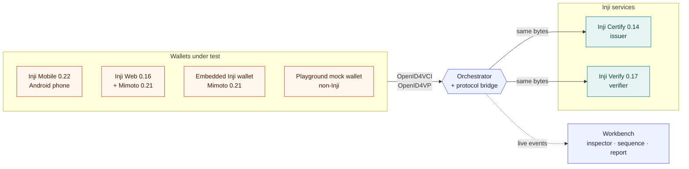
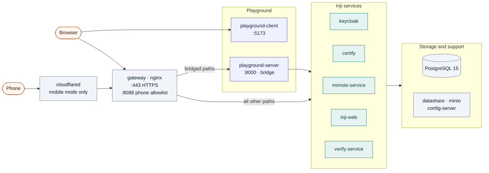
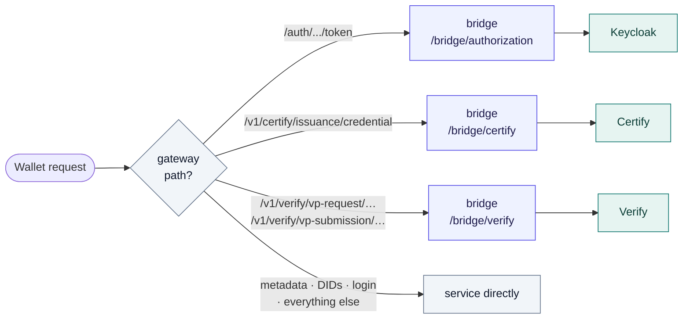
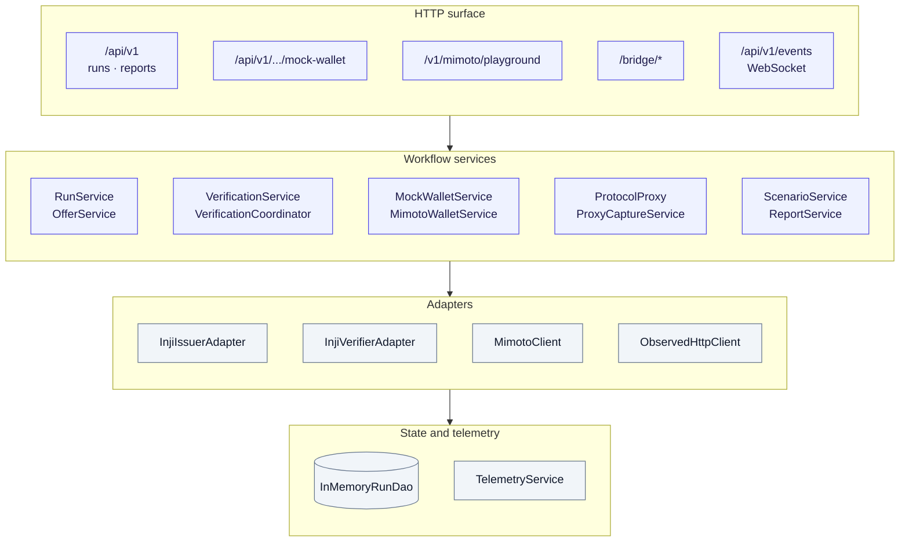
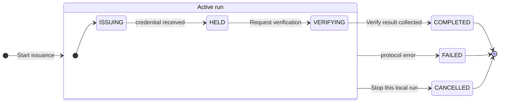
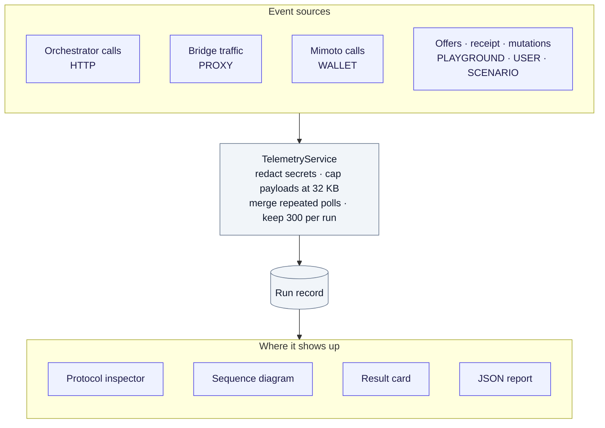

# Architecture

The playground runs the real Inji services and adds two things around them: a **workbench** where you choose and drive a flow, and an **orchestrator with a protocol bridge** that sits on the wallet's network path and records every exchange. It never signs or verifies credentials on Inji's behalf, and it does not simulate verdicts.

This document describes the system as built. For the protocol steps, see [PROTOCOL_FLOWS.md](PROTOCOL_FLOWS.md); for negative testing and scoring, [SCENARIOS.md](SCENARIOS.md); for endpoints, [API.md](API.md); for the interface, [DESIGN.md](DESIGN.md).

## The problem it solves

In a real credential flow, the wallet talks to the issuer and the verifier directly. A web page that only shows a QR code never sees the token exchange, the proof of possession, the issued credential or the `vp_token`. To show those payloads without rewriting the identities that wallets trust, the playground routes the wallet's protocol traffic through a byte-preserving bridge on the same public origin:

- The issuer and verifier keep their canonical `did:web` identities and URLs. No QR code points at a different host.
- The HTTPS gateway sends a short list of protocol paths (`/token`, `/credential`, `vp-request`, `vp-submission`) to the bridge. The bridge forwards them unchanged, then records the request and response against the active run.
- The orchestrator calls Certify and Verify itself for discovery, request creation and results. Those calls are recorded too.

## System context

Four wallets can play the holder:

| Workbench option | Holder | Who holds the keys | Formats |
| --- | --- | --- | --- |
| **Inji wallet · in this page** | Mimoto, driven from the workbench | Mimoto | JSON-LD |
| **Inji Web · external** | Inji Web in its own tab, backed by Mimoto | Mimoto | JSON-LD (SD-JWT issues, but Mimoto 0.21 cannot present it) |
| **Inji Mobile** | The Android app, through mobile mode | The phone | JSON-LD, SD-JWT, mDoc (issuance and storage only) |
| **Playground mock wallet · non-Inji** | An independent OpenID4VCI / OpenID4VP holder in the orchestrator | The orchestrator (memory) | SD-JWT |

## Deployment

`npm start` renders the configuration and starts one Docker Compose project. Everything listens on `127.0.0.1` only.

| Service | Image | Role |
| --- | --- | --- |
| `certify` | `inji-certify-with-plugins:0.14.0` + local patch | OpenID4VCI issuer. A local data provider creates a synthetic farmer record per signed-in user. |
| `mimoto-service` | `mimoto:0.21.0` + local patch | Wallet backend for Inji Web and the embedded wallet. |
| `inji-web` | `inji-web:0.16.0` | Browser wallet. |
| `verify-service` | `inji-verify-service:0.17.0` | OpenID4VP verifier. |
| `keycloak` | Keycloak 26.0.8 + nonce mapper | Authorization server, standing in for eSignet. Supports self-registration. |
| `database` | PostgreSQL 15.10 | Certify, Mimoto, Verify and Keycloak data. |
| `datashare-service`, `minio-service`, `config-server` | MOSIP support services | Required by Mimoto. |
| `gateway` | nginx 1.26 | One HTTPS origin, `https://inji.127.0.0.1.sslip.io`, plus the mobile allowlist on `8088`. |
| `playground-server`, `playground-client` | Built from this repository | Orchestrator and bridge; workbench. |
| `tunnel` | `cloudflared` (profile `mobile`) | Phone-reachable HTTPS URL, only while mobile mode is on. |

The local patches are small and documented next to their Dockerfiles in [`infra/inji/images/`](../infra/inji/images/). Each one fixes a compatibility gap listed in [INTEROP_GAPS.md](INTEROP_GAPS.md).

## Where the bridge sits

The gateway decides, per path, whether a request goes through the bridge or straight to the service. Only the exchanges that carry protocol payloads take the detour. Login pages, metadata and DID documents stay direct.

| Bridge prefix | Upstream | Enabled paths |
| --- | --- | --- |
| `/bridge/certify` | `INJI_CERTIFY_URL` | `/.well-known/openid-credential-issuer`, `/credential`, `/nonce`, `/notification` |
| `/bridge/authorization` | `INJI_AUTHORIZATION_URL` | `/token`, `/oauth/token`, `/protocol/openid-connect/token`, `/.well-known/openid-configuration` |
| `/bridge/verify` | `INJI_VERIFY_URL` | `/vp-request/*`, `/vp-response/*`, `/vp-submission/*`, `/presentation-definition/*` |

Bridge rules:

- **Forwarding.** Only GET and POST are forwarded; bodies are limited to 5 MB. Bytes are forwarded unchanged unless a selected negative scenario mutates a presentation copy (see [SCENARIOS.md](SCENARIOS.md)). Callback URLs and redirects are never rewritten.
- **Errors.** Only an upstream failure produces a 502 (or a 504 on timeout). A failure while recording is logged and never replaces the upstream response.
- **Correlation.** One run is active at a time. Token exchanges seen during issuance link tokens to that run, and a `/credential` response is attributed only when its token was seen. Verifier traffic is attributed only after the run has created its verifier request.
- **Visibility limits.** Direct traffic that skips the gateway, browser login pages and encrypted payloads are not observable.

## Orchestrator components

The server is an Express 5 application composed in [`server/app.ts`](../server/app.ts). Services receive their dependencies through constructors, so protocol adapters, storage and transport can be replaced without touching the workflow.

| Component | Responsibility |
| --- | --- |
| `RunService`, `OfferService` | Start runs, discover issuer configurations, build or accept credential offers, record holder receipt. |
| `VerificationService`, `VerificationCoordinator` | Create the Verify request, poll its status every 3 s (15 s after a failed poll) and collect the result, even after you leave the workbench. For mDoc, which Verify cannot receive over OpenID4VP, send the bridge-observed credential to Verify's credential check instead. |
| `PresentationChecks` | The playground's own checks on the submission: request binding, nonce, audience, descriptor, format, proof, claims and result correlation. |
| `ScenarioService` | Apply and record negative-scenario mutations and score them. |
| `MockWalletService` | The non-Inji holder: authorization code + PKCE, `did:jwk` proof, SD-JWT presentation with a Key Binding JWT. It authenticates the verifier's signed request before sharing. |
| `MimotoWalletService` | Drives Mimoto's wallet APIs for the embedded wallet, keeping Mimoto's session cookies and CSRF protection. |
| `ProtocolProxy`, `ProxyCaptureService` | The bridge: forward, record, correlate. An issued mDoc is decoded from CBOR (`run-service/mdoc.ts`) into an inspection-only event. |
| `TelemetryService`, `TelemetrySocket` | Redact, store and stream events to the browser. |
| `ReportService` | Build the exportable JSON report (version 3). |

## Run lifecycle

Each run moves through the same phases whatever the wallet. The workbench, the inspector and the report all read this one record.

How a run reaches **HELD** depends on who holds the credential:

| Wallet | Receipt evidence |
| --- | --- |
| Inji wallet · in this page | Mimoto's storage API returns the stored credential ID. |
| Playground mock wallet | The mock wallet stores the credential it received through the bridge. |
| Inji Mobile, Inji Web | You select **I received the credential**. The report labels this as user confirmation, and the bridge separately records whether it saw the `/credential` response. |

**Replay with a scenario** on a finished run starts a new, linked run (`parentRunId`) with fresh issuance and a fresh verifier request. It never resends an old `vp_token`.

## Telemetry pipeline

- Secrets are redacted before anything is stored or sent: authorization headers and cookies, access, refresh and ID tokens, authorization codes and PKCE verifiers, client secrets and assertions, wallet PINs and passwords.
- Identical consecutive status polls are merged and shown as ×N, so polling cannot push issuance evidence out of the 300-event window.
- WebSocket messages only tell the browser that a run changed; the browser then refetches the run over REST.

## The workbench

The client is React 19 with Vite, Tailwind CSS 4, TanStack Query (server state) and Zustand (selection state). API mutations are not retried automatically.

| View | What it shows |
| --- | --- |
| **Workbench** | Issuer → holder → verifier topology, flow configuration, the QR code or wallet panel for the current step, and the result card. |
| **View sequence flow diagram** | A live Mermaid sequence diagram of the run, built from the same events as the inspector. New arrows animate in, failed responses are drawn as red crossed arrows, and selecting an arrow opens its payload. Mermaid loads only when the dialog opens. |
| **Protocol inspector** | Every captured exchange with request and response, JWT / SD-JWT decoding, and the verification evidence. |
| **Run history** | Past runs with filters for outcome, format, scenario and stack version, and per-run report export. |

## Configuration

`prepare.mjs` renders everything under `infra/inji/generated/` from the root `.env` and the shared development secrets. The orchestrator reads these values:

| Variable | Purpose |
| --- | --- |
| `INJI_CERTIFY_URL`, `INJI_ISSUER_URL` | Certify's upstream base and its canonical issuer identifier. They differ when the bridge is used, but the identifier must match Certify metadata exactly. |
| `INJI_VERIFY_URL`, `INJI_VERIFIER_CLIENT_ID` | Inji Verify's v1 base (ending in `/v1/verify`) and the verifier's client ID. |
| `INJI_PRESENTATION_DEFINITION_IDS` | One existing presentation definition per format, for example `ldp_vc=<id>,vc+sd-jwt=<id>`. |
| `INJI_AUTHORIZATION_URL` | The authorization server the bridge forwards token requests to. |
| `INJI_MIMOTO_URL`, `INJI_WEB_URL`, `INJI_EMBEDDED_WALLET_URL` | Mimoto, and the Inji Web and embedded wallet pages. Without the last two, those wallet options are unavailable. |
| `INJI_STACK_VERSION` | Recorded on every run, so history can be filtered by stack version. |
| `PUBLIC_BASE_URL` | The bridge prefix shown to users. Setting it does not reconfigure Inji or create connectivity. |

To point the playground at another Inji environment, that environment must already advertise bridge URLs in its metadata and callbacks, preserving its canonical issuer and verifier identities. Issuer-led offer creation APIs vary by Certify release, so the playground supports wallet-initiated downloads and offers that you paste in; it does not call Certify's administrative APIs.

## Design decisions

| Decision | Why |
| --- | --- |
| Real services, no simulated verdicts | Pass and fail must come from Inji Verify, so a result is evidence about the stack. |
| A bridge on the existing origin instead of rewriting QR targets | Wallets check that the issuer and verifier identities match their DIDs. Rewriting hosts would change the thing under test. |
| The playground's own checks alongside Verify's | Verify's result alone missed several mismatches (see [INTEROP_GAPS.md](INTEROP_GAPS.md)). The playground re-checks bindings independently and reports both. |
| Keycloak instead of eSignet | A self-contained local stack. A small custom mapper adds the credential nonce, and each client adds a `client_id` claim: Certify and Mimoto expect both from eSignet-style tokens. |
| No `@mosip/react-inji-verify-sdk` component | SDK 0.16.0 bundles React 18 internals and cannot mount in React 19. The client uses the same documented Verify HTTP contracts through an adapter. |
| No PixelPass | Offers and requests are sent by reference. Anything over the 2000-byte QR policy falls back to a copyable link. |
| In-memory history (100 runs, 300 events each) | A local test bench. Export reports before restarting the server. |
| One active run at a time | Bridge traffic carries no run identifier, so correlation relies on a single active run. |

## Code organization

| Path | Contents |
| --- | --- |
| `server/models` | DTOs, adapter and repository contracts, the in-memory DAOs, and the pure scenario catalog and outcome rules (shared with the client). |
| `server/services` | Workflow services, Inji adapters, mock and embedded wallets, the bridge and telemetry, grouped by feature. |
| `server/controllers` | HTTP route translation. `app.ts` is the composition root; `index.ts` starts the listener and handles shutdown. |
| `client/src/api`, `services` | Typed API transport, query hooks, WebSocket lifecycle, presentation helpers and the Mermaid sequence builder. |
| `client/src/pages`, `components` | Routed views and feature components. |
| `infra/inji/scripts` | `prepare`, `bootstrap`, `upgrade` and `mobile`, with their renderers and tests. |
| `infra/inji/images` | Local patches on the pinned Certify, Mimoto and Keycloak images. |
| `infra/inji/config`, `migrations`, `upstream` | Gateway configuration, SQL migrations and pinned upstream seeds. |
