# Design

How the workbench is laid out and why, with the user flows, wireframes and the screens as built. The approved visual design was created in MagicPath; the screenshots below are the running application.

## Design goals

A protocol test bench can easily become a wall of JSON. The workbench keeps one question on screen at a time.

| Principle | In the workbench |
| --- | --- |
| **One step at a time** | Configure, Issue & hold, and Present & verify are separate stages. The panel shows only the current one. |
| **Evidence beside the verdict** | The result card shows why a run passed or failed, and leads to the exact exchange. |
| **Details on request** | Passing checks, applied changes and wallet links stay collapsed. Failed checks are always open. |
| **Plain, honest language** | "HTTP status shows delivery, not credential acceptance." Inji's verdict and the playground's own checks are never merged. |
| **Say why, not just no** | Unavailable combinations are disabled with the reason, such as why Mimoto cannot present SD-JWT. |

## Screen map

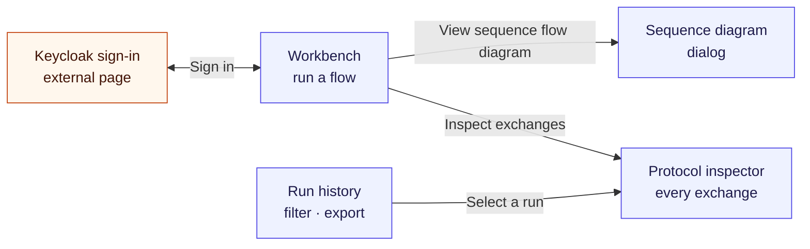

The sidebar moves between the Workbench, Protocol inspector and Run history at any time.

## User flow

Every wallet follows the same journey. Only the issuance and sharing steps differ.

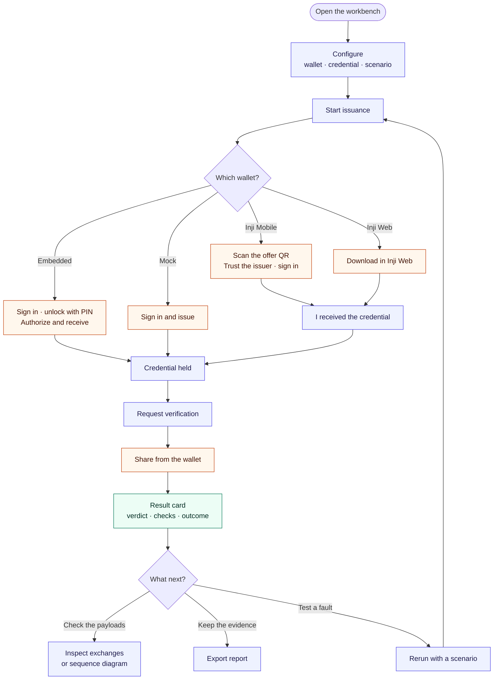

## Wireframes

### Workbench

```text
+-----------+--------------------------------------------------------------+
| inji.     | Inji stack / Developer workspace           (•) Live updates  |
|           +--------------------------------------------------------------+
| Workbench |  One flow. Every exchange.                                   |
| Inspector |                                                              |
| History   |  (1) Configure -> (2) Issue & hold -> (3) Present & verify   |
|           |                                [View sequence flow diagram]  |
|           |  +--------------+   +--------------+   +--------------+      |
|           |  | 01 / ISSUER  |   | 02 / HOLDER  |   | 03 / VERIFIER|      |
|           |  | Inji Certify |   | chosen wallet|   | Inji Verify  |      |
|           |  +--------------+   +--------------+   +--------------+      |
|           |  +-----------------------------+   +--------------------+    |
|           |  | CURRENT STAGE               |   | Follow the protocol|    |
|           |  |                             |   |                    |    |
|           |  | Configure: wallet,          |   | Latest exchanges   |    |
|           |  |   credential, scenario      |   | with HTTP status   |    |
|           |  | Issue: QR code or wallet    |   |                    |    |
|           |  | Verify: QR code or approval |   | Open protocol      |    |
|           |  | Result: verdict and checks  |   | inspector ->       |    |
|           |  +-----------------------------+   +--------------------+    |
+-----------+--------------------------------------------------------------+
```

### Protocol inspector

```text
+-----------+--------------------------------------------------------------+
| inji.     |  Every exchange, in context.                                 |
|           |  [ Run: selected run        v ]  [ Filter exchanges        ] |
| Workbench |  +--------------------------------------------------------+  |
| Inspector |  | Verification evidence: verdict, checks, match, receipt |  |
| History   |  +--------------------------------------------------------+  |
|           |  +--------------------+-----------------------------------+  |
|           |  | EXCHANGES          | Selected exchange      [copy][full]|  |
|           |  | 01 Issuer metadata | [Request] [Response]  [ ] Decode   |  |
|           |  | 02 Credential offer| POST https://…                     |  |
|           |  | 03 /token          | { raw JSON payload,                |  |
|           |  | 04 /credential     |   tokens redacted }                |  |
|           |  | 05 …               |                                    |  |
|           |  +--------------------+-----------------------------------+  |
+-----------+--------------------------------------------------------------+
```

## From the problem statement's mock to the build

| Mock in the brief | In the workbench |
| --- | --- |
| Issuer, wallet and verifier columns | Issuer, holder and verifier cards, with the wallet and credential chosen under **Configure your flow** |
| Step 1: Issue → Step 2: Verify | Three-step indicator, adding **Configure** |
| Active workflow panel with QR code or status | The current stage panel |
| Protocol inspector panel | **Follow the protocol** beside each stage, and a full **Protocol inspector** page, so payloads get the room they need |
| Result: pass or fail with an error log | Result card with the verdict, each check, and the outcome |

## Screens

### Configure

Choosing a wallet explains what it needs. Choosing a scenario states what is expected.

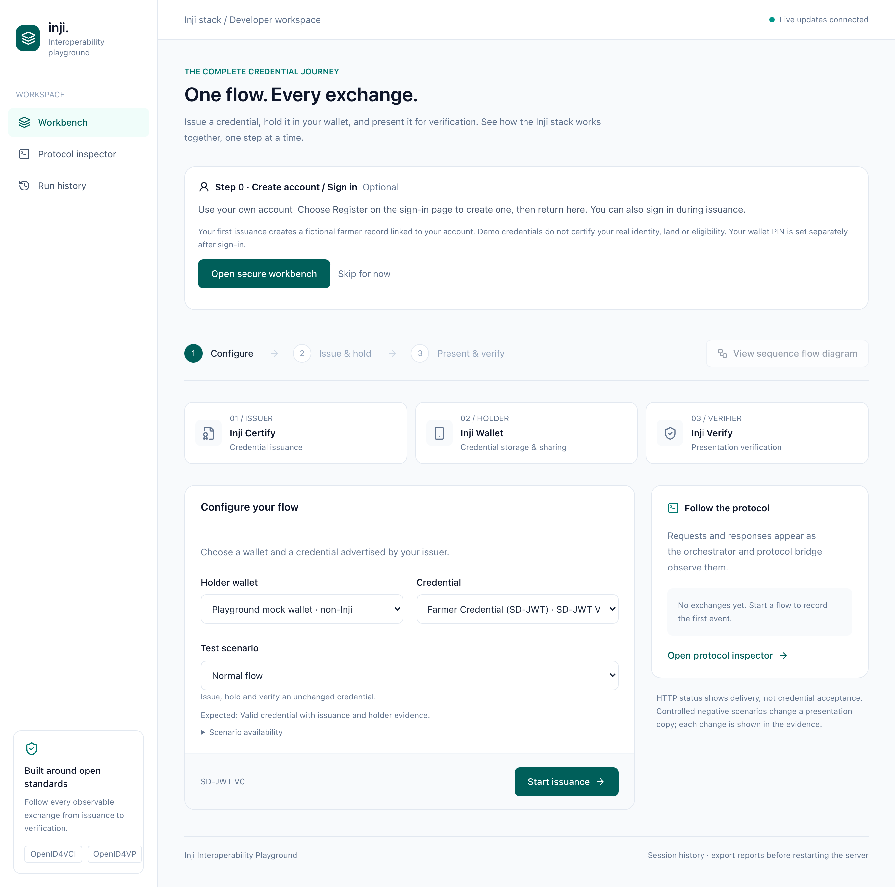

For Inji Mobile, the workbench says whether the phone can reach the issuer, and what to do if it cannot.

| Ready | Not ready |
| --- | --- |
| 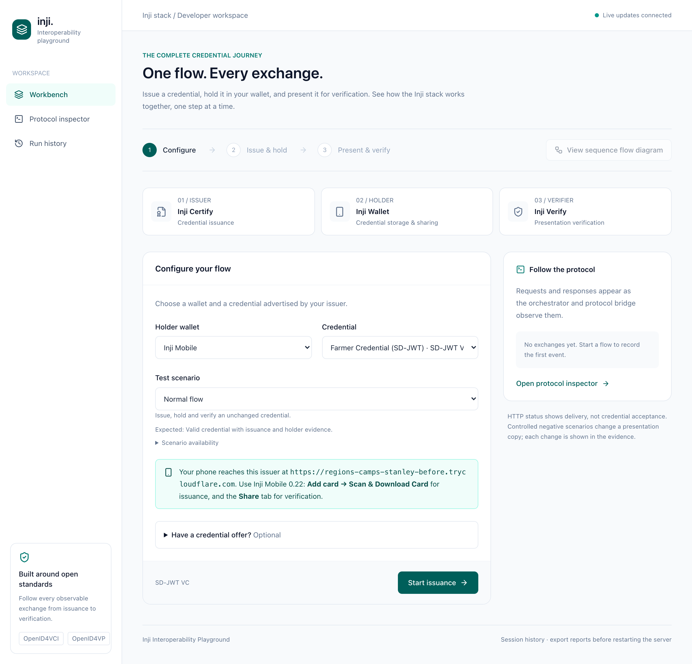 | 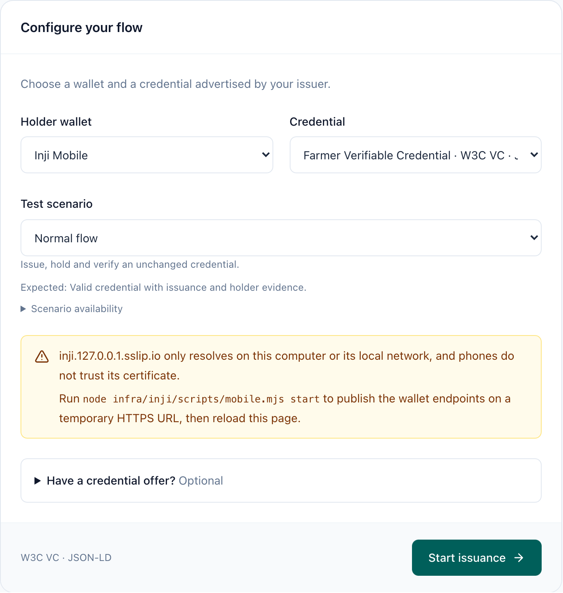 |

### Issue and verify

Each QR code comes with the exact steps in the app, and a copyable link for requests too large to scan.

| Issuance | Verification |
| --- | --- |
| 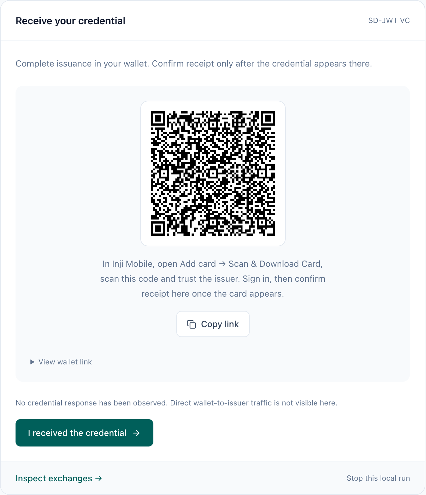 | 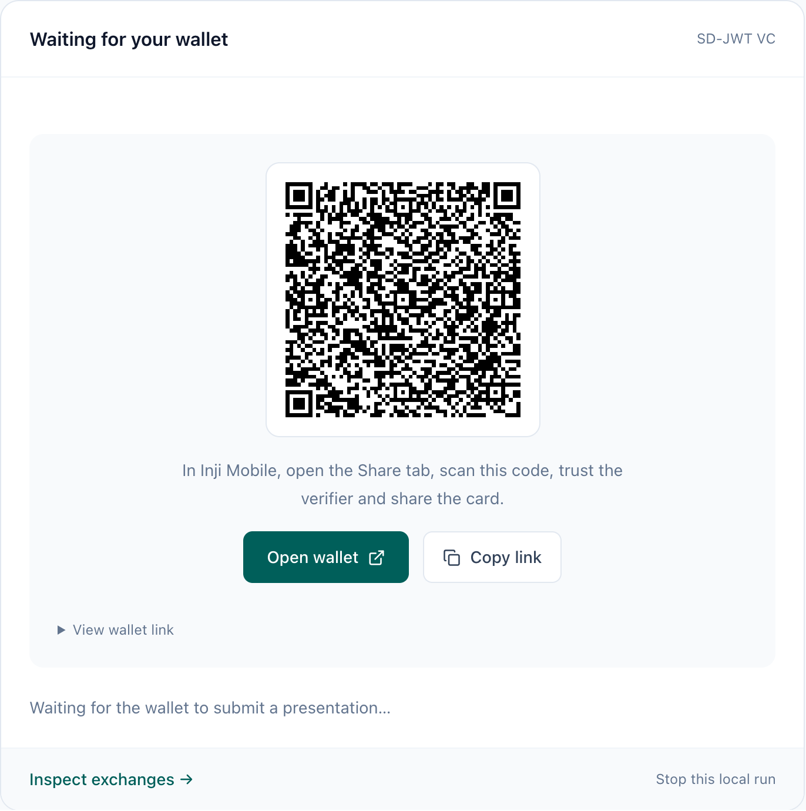 |

### Results

A pass, a correct rejection and an interoperability gap each read differently, and each one names the check responsible.

| Pass | Correct rejection | Gap found |
| --- | --- | --- |
| 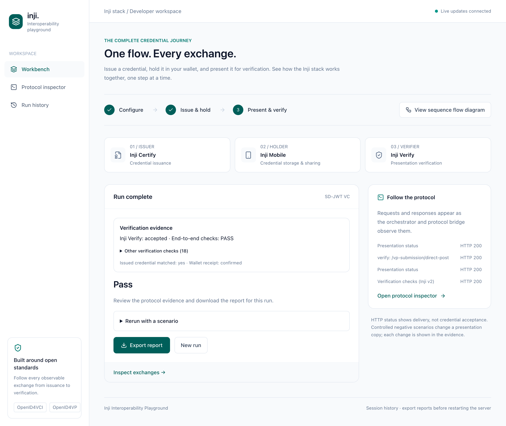 | 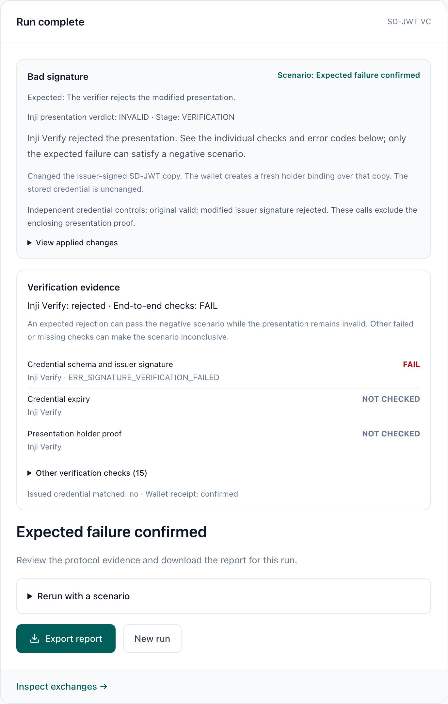 | 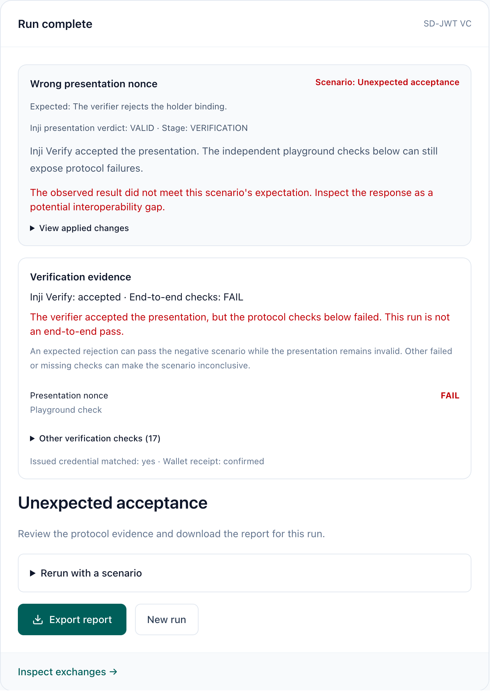 |

### Sequence diagram

A live Mermaid diagram of the run. Arrows animate in as exchanges are observed, and selecting one opens its payload. This one is from a run on a physical phone.

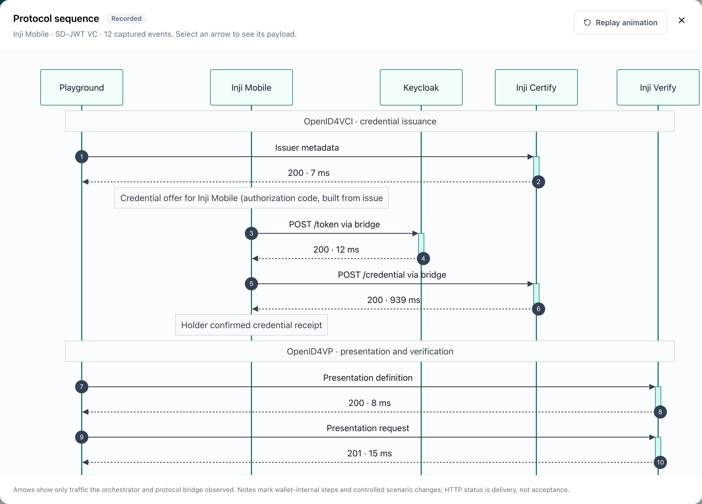

### Protocol inspector

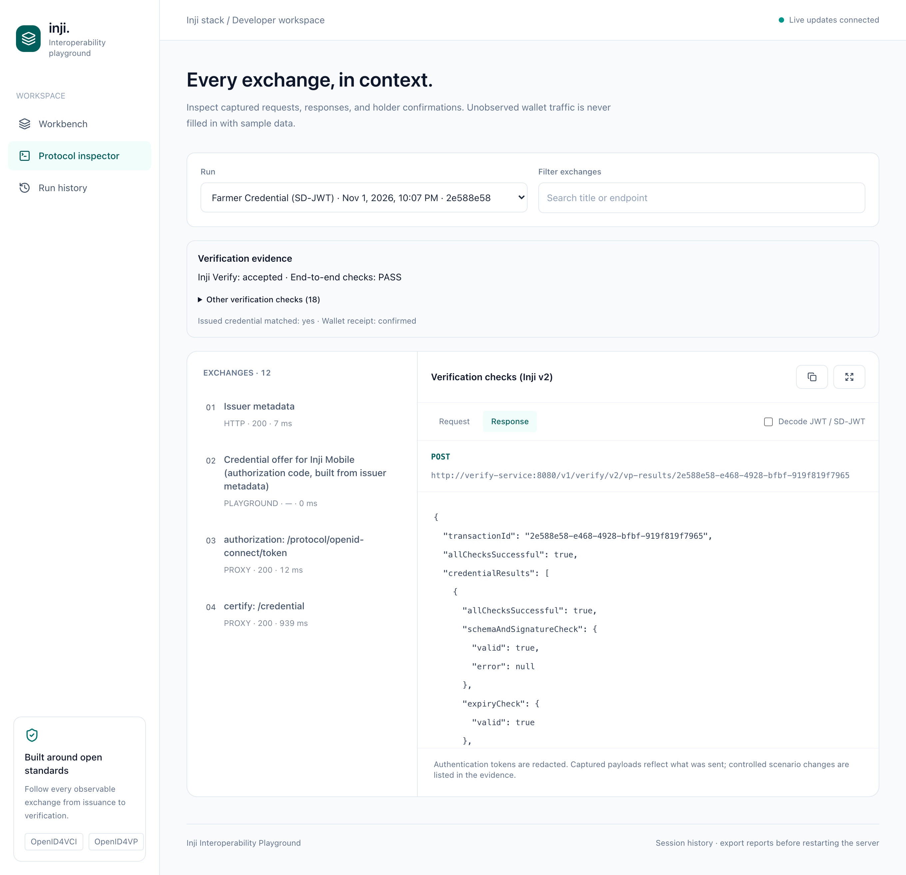

### Run history

Summary counts, filters for outcome, format, scenario and stack version, and a report download per run.

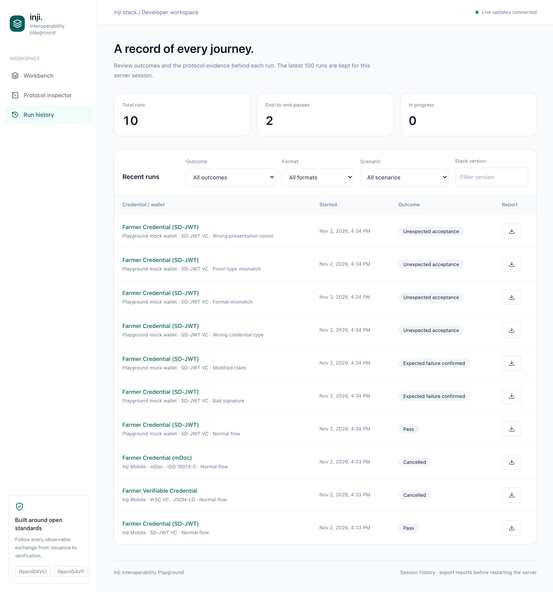
