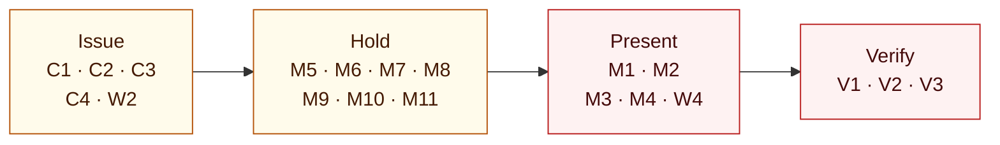

# Interoperability gaps

Real gaps found while running the pinned Inji stack end to end, in the spirit of the problem statement's second goal: *surface real interoperability gaps that the core teams can act on.* Each one was observed in a live run. Where the playground works around it, the workaround is named so it can be removed once the upstream fix lands.

**Severity:** **High** breaks a standard flow, or accepts something it should reject. **Medium** needs a workaround, or hides the real cause. **Low** is operational. **Info** is expected behaviour that integrators should know about.

## Where they bite

The stages with a high-severity gap are red: SD-JWT presentation through Mimoto, and Verify accepting presentations it should reject.

## Inji Verify 0.17

| ID | Severity | Gap | Evidence | Workaround here |
| --- | --- | --- | --- | --- |
| V1 | High | Accepts an SD-JWT presentation whose Key Binding JWT carries a **different nonce** from the request. The nonce is what stops a captured presentation being replayed. | Wrong-nonce runs `a7a3117a` (31 Oct) and `7640db4e` (26 Oct): VALID. The playground's nonce check fails. | None. The playground reports it as *Unexpected acceptance*. |
| V2 | High | Accepts SD-JWT presentations that **do not satisfy the presentation definition**: a different credential type, a different format, or a different proof algorithm. | Runs `bafe0ca5`, `35de2d04`, `9730301c` (31 Oct): VALID. | None. Inji wallets refuse to match first, so the gap shows only with other wallets. |
| V3 | Medium | Returns **HTTP 500** when a wallet posts an OpenID4VP error response (`error=access_denied`) to `direct-post`: it tries to store a submission with a null `vp_token`. The wallet's refusal is lost. | 21 Oct, after declining in Inji Web. | None. Stopping the local run does not cancel the upstream request. |

## Mimoto 0.21 and Inji Web 0.16

| ID | Severity | Gap | Evidence | Workaround here |
| --- | --- | --- | --- | --- |
| M1 | High | **Cannot present SD-JWT** over OpenID4VP: "Unsupported credential format: vc+sd-jwt. Only ldp_vc format is supported." Inji Web receives HTTP 400. The same check exists in Mimoto 0.22.0; SD-JWT presentation first appears in v1.0.0-alpha.1. | 21 Oct, Inji Web SD-JWT journey. | Use the mock wallet or Inji Mobile for SD-JWT. |
| M2 | High | **Cannot match SD-JWT** credentials when an input descriptor declares `format` or constraint fields: `matchesFormat` returns false for anything but `ldp_vc`, and field evaluation throws `UNSUPPORTED_FORMAT`. | Source of `CredentialMatchingServiceImpl`, 21 Oct. | As M1. |
| M3 | Medium | Evaluates a Presentation Exchange `filter.pattern` with `String.contains` instead of as a regular expression. The spec-valid `^FarmerCredential$` never matches, and the user sees "No matching credentials found — Missing: type[*]". `const` filters are likely unsupported too. | 21 Oct; run `7e2f9996` stopped at matching (26 Oct). | Migration `003` uses the unanchored pattern `FarmerCredential`. |
| M4 | Medium | Puts the wallet's storage UUID in `descriptor_map.id` instead of the input descriptor ID, so the submission does not reference the request. | 26 Oct review. | Patched in [`infra/inji/images/mimoto`](../infra/inji/images/mimoto/README.md). |
| M5 | Medium | Rejects a browser `Accept-Language` list with HTTP 400 "Locale must be a 2-letter code", so credential listing fails from Chrome. | 29 Oct, embedded wallet in Chrome. | The workbench's Mimoto client sends `en`. |
| M6 | Low | Reports a locked wallet as HTTP 400 `wallet_locked` rather than 401, 403 or 423, so clients show an error instead of the PIN form. | 29 Oct. | The workbench routes `wallet_locked` to unlock. |
| M7 | Medium | Throws on repeat login when the user has no profile picture. | 17 Oct. | Null-safe patch in `infra/inji/images/mimoto`. |
| M8 | Low | Caches issuer metadata: a credential configuration added to Certify is not offered until Mimoto restarts. | 21 Oct. | Restart Mimoto after issuer changes (`npm run upgrade` does). |
| M9 | Low | The generic HSM health probe assumes a directly stored symmetric key and reports the wallet unhealthy. | 17 Oct. | A local health indicator checks the actual encryption service. |
| M10 | Medium | Storing a credential whose issuer DID cannot be resolved fails with a generic HTTP 500 `internal_server_error`, hiding the cause. | Unsupported-DID scenario, 26 Oct. | The scenario is reported as inconclusive rather than as a pass. |
| M11 | Medium | Mimoto's credential verifier does not decode a port in a `did:web` host (`%3A`). | 17 Oct. | Local identities use HTTPS on port 443. |

## Inji Certify 0.14

| ID | Severity | Gap | Evidence | Workaround here |
| --- | --- | --- | --- | --- |
| C1 | Medium | On a rejected proof it returns `invalid_proof` **without a fresh `c_nonce`**, and it has no Nonce Endpoint. An OpenID4VCI wallet has no way to retry. | Checked live on 28 Oct: `{"error":"invalid_proof","error_description":"Error encountered during proof jwt parsing."}`. | The bridge fails the run instead of leaving it waiting for a retry that cannot happen. |
| C2 | Medium | Expects eSignet-style access tokens with `c_nonce` and `client_id` claims, so a standard OAuth server cannot be used as is. It also rejects tokens without `sub`. | 17 Oct; `invalid_token` "The sub claim is not valid" on 28 Oct. | A small Keycloak mapper adds the nonce, each client adds `client_id`, and the `basic` scope supplies `sub`. |
| C3 | Low | With several credential scopes granted by default, issuance can resolve an unrelated default scope. | 26 Oct. | The JSON-LD scope is optional and requested explicitly. |
| C4 | Low | The Farmer JSON-LD context file in the upstream Certify snapshot is empty. | 17 Oct. | Restored from the source its template references and validated by `prepare`. |

## Inji Mobile 0.22

| ID | Severity | Gap | Workaround here |
| --- | --- | --- | --- |
| W1 | Info | Trusts only publicly issued TLS certificates, so a phone cannot use a local development stack directly. | Mobile mode publishes an allowlisted listener through a Cloudflare quick tunnel. |
| W2 | Low | Splits the `credential_offer` query on `=`, so any `=` inside the offer must be percent-encoded. | Offers are fully percent-encoded. |
| W3 | Info | Asks the user to trust an issuer or verifier that is not in its built-in backend's list. | The workbench and README tell users to accept the prompts. |
| W4 | Info | Sends a single SD-JWT `vp_token` as a JSON string, quote marks included (`"eyJ…~…"`), where other wallets send it bare. Inji Verify decodes it, but a verifier that reads the parameter as is hashes the wrong bytes, so the holder binding and credential matching fail. Found on the first phone run, 1 November. | The playground's checks decode it, and the simulator now sends it the same way. |

## Tooling

| ID | Severity | Gap | Workaround here |
| --- | --- | --- | --- |
| S1 | Medium | `@mosip/react-inji-verify-sdk` 0.16.0 bundles React 18 internals and cannot be mounted in a React 19 application. | The client calls the same documented Verify HTTP contracts through an adapter. |

## Filing upstream

None of these has been filed yet. Suggested destinations:

| Repository | Gaps |
| --- | --- |
| `inji-verify` | V1, V2, V3, S1 |
| `mimoto` | M1 to M11 (M1 and M2 may already be fixed in v1.0.0) |
| `inji-certify` | C1, C2, C3, C4 |
| `inji-wallet` | W2 |

Each issue should name the pinned version, the request and response from an exported run report (secrets are already redacted), and the expected behaviour from the specification.
