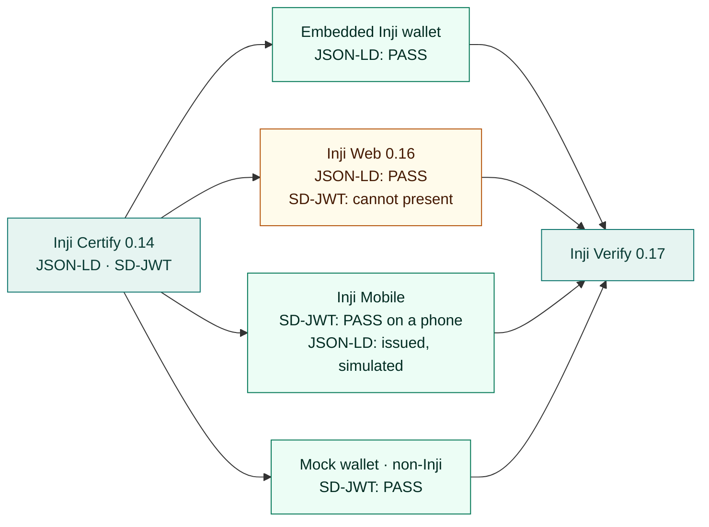

# Interoperability matrix

Which issuer, wallet, verifier and format combinations were run end to end, and what happened. Every result comes from a real run against the pinned services between 17 October and 1 November 2026. Run IDs are listed so each one can be traced in [LIVE_VALIDATION.md](LIVE_VALIDATION.md) or in the exported reports under [evidence/](evidence/).

## Versions under test

| Role | Component | Version |
| --- | --- | --- |
| Issuer | Inji Certify (with plugins) | 0.14.0 |
| Wallet backend | Mimoto | 0.21.0 |
| Browser wallet | Inji Web | 0.16.0 |
| Mobile wallet | Inji Mobile | The Android app on a physical phone, and 0.22.1 behaviour reproduced from its source with `inji-vci-client` 0.7.0 and `inji-openid4vp` 0.7.0 |
| Verifier | Inji Verify service | 0.17.0 |
| Authorization server | Keycloak, standing in for eSignet | 26.0.8 |
| Non-Inji wallet | Playground mock wallet | this repository |

## At a glance

## End-to-end journeys

| Issuer | Wallet | Verifier | Format | Proof | Result | Runs |
| --- | --- | --- | --- | --- | --- | --- |
| Certify 0.14 | Embedded Inji wallet (Mimoto 0.21) | Verify 0.17 | W3C VC JSON-LD (`ldp_vc`) | Ed25519Signature2020 | ✅ **PASS** | `c1c81eea` in a browser, 29 Oct; `4d19e663` and self-registered `be7866e6`, 26 Oct |
| Certify 0.14 | Inji Web 0.16 / Mimoto 0.21 | Verify 0.17 | JSON-LD | Ed25519Signature2020 | ✅ **PASS** | `23560c16`, 21 Oct |
| Certify 0.14 | Playground mock wallet (non-Inji) | Verify 0.17 | SD-JWT VC (`vc+sd-jwt`) | ES256 issuer signature, `did:jwk` holder, ES256 Key Binding JWT | ✅ **PASS** | `60818b03`, 21 Oct; `e5ebfa10` in a browser, 29 Oct; `93cf58e8`, 31 Oct |
| Certify 0.14 | Inji Mobile on a physical Android phone, over a real public tunnel | Verify 0.17 | SD-JWT VC | ES256 issuer signature, `did:jwk` holder, ES256 Key Binding JWT | ✅ **PASS** | `2e588e58`, 1 Nov |
| Certify 0.14 | Inji Mobile 0.22.1, simulated, over a real public tunnel | Verify 0.17 | SD-JWT VC | ES256 | ✅ **PASS** | `2fd6b5f8` and workbench run `7704c19b`, 28 Oct; `6584a138` and `238ffec5`, 31 Oct |
| Certify 0.14 | Inji Mobile 0.22.1, simulated | Verify 0.17 | JSON-LD | Ed25519Signature2020 | 🟡 Issued; verifier request authenticated | `206d749f`, 28 Oct; `d6374cae`, 31 Oct. Signing the JSON-LD presentation needs the real app. |
| Certify 0.14 | Inji Web 0.16 / Mimoto 0.21 | Verify 0.17 | SD-JWT VC | ES256 | ❌ Issued and stored, then **presentation fails in Mimoto** | 21 Oct; gaps [M1, M2](INTEROP_GAPS.md#mimoto-021-and-inji-web-016) |

Combinations that cannot run on this stack:

| Combination | Why |
| --- | --- |
| Embedded Inji wallet with SD-JWT | Mimoto 0.21 cannot present SD-JWT ([M1](INTEROP_GAPS.md#mimoto-021-and-inji-web-016)). |
| Mock wallet with JSON-LD | The mock wallet implements SD-JWT only. |

Evidence: [browser-mimoto](evidence/browser-mimoto-2026-10-29.json), [browser-mock-wallet](evidence/browser-mock-wallet-2026-10-29.json), [mimoto](evidence/mimoto-2026-10-26.json), [signup](evidence/signup-2026-10-26.json), [mobile-sd-jwt](evidence/mobile-sd-jwt-2026-10-28.json), [mobile-phone](evidence/mobile-phone-2026-11-01.json).

## Negative scenarios

What happened when the playground deliberately broke something. See [SCENARIOS.md](SCENARIOS.md) for how each fault is applied and scored.

| Scenario | Embedded Inji wallet · JSON-LD | Mock wallet · SD-JWT |
| --- | --- | --- |
| Normal flow | VALID · ✅ PASS | VALID · ✅ PASS (`93cf58e8`) |
| Bad signature | INVALID · ✅ rejected (`63dfef98`) | INVALID · ✅ rejected (`4a8342cb`) |
| Modified claim | INVALID · ✅ rejected | INVALID · ✅ rejected (`47193725`) |
| Expired credential | EXPIRED · ✅ rejected | Not applicable: JSON-LD fixture |
| Wrong credential type | Wallet refused to match · ✅ | VALID · ❌ **accepted** (`bafe0ca5`) |
| Format mismatch | Wallet refused to match · ✅ | VALID · ❌ **accepted** (`35de2d04`) |
| Proof-type mismatch | Wallet refused to match · ✅ | VALID · ❌ **accepted** (`9730301c`) |
| Unsupported DID | Mimoto storage HTTP 500 · 🟡 inconclusive | Not applicable: JSON-LD fixture |
| Wrong nonce | Not applicable: the wallet controls its binding | VALID · ❌ **accepted** (`a7a3117a`) |

How to read the ❌ rows: the mock wallet submits on purpose even when the request does not match, to test whether the verifier enforces the request by itself. Inji Verify 0.17 did not ([V1, V2](INTEROP_GAPS.md#inji-verify-017)). With the Inji wallets, Mimoto's matching stops the mismatch before Verify sees it.

Evidence: [negative-scenarios](evidence/negative-scenarios-2026-10-26.json), [review-scenarios](evidence/review-scenarios-2026-10-26.json), [review-bad-signature](evidence/review-bad-signature-2026-10-26.json); the 31 October rerun is recorded in [LIVE_VALIDATION.md](LIVE_VALIDATION.md#after-merging-the-review-and-mobile-work--31-october-2026).

## Not covered

| Area | Status |
| --- | --- |
| Other issuers and verifiers | Only Inji Certify and Inji Verify were tested. No external OpenID4VCI issuer or OpenID4VP verifier mock was built; the non-Inji party is the wallet. |
| mDoc / mDL (ISO/IEC 18013-5) | Not implemented. |
| RSA proof suites | Not tested; the stack issues Ed25519Signature2020 and ES256. |
| JSON-LD from Inji Mobile on a phone, and iOS | Not run. SD-JWT passed on a physical Android phone; the simulator covers JSON-LD issuance only. |
| MOSIP Collab sandbox | Not used; everything ran on the local stack. |

## Reproduce or extend

1. Start the stack with `npm start` and open the workbench.
2. Pick a wallet, a credential and optionally a scenario, then run the flow.
3. In **Run history**, filter by outcome, format, scenario or stack version, and export each run's report.

For Inji Mobile without a phone, `node infra/inji/scripts/mobile.mjs start` followed by `node infra/inji/scripts/mobile.mjs rehearse` (SD-JWT) or `rehearse --format ldp_vc` replays the app's requests over a public tunnel.
