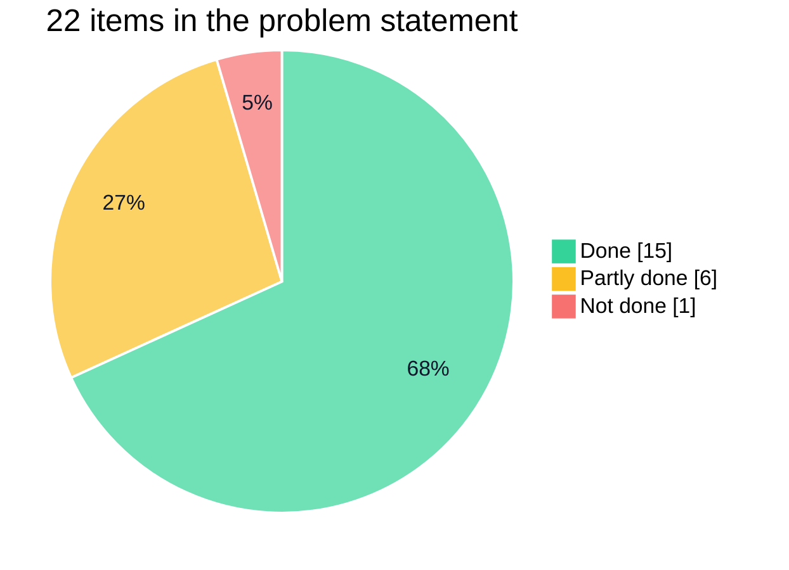

# Problem statement coverage

How the playground answers [MOSIP Decode problem statement 02](02_Interoperability_Playground_for_Verifiable_Credentials.pdf) ([text version](PROBLEM_STATEMENT.md)), item by item. Status is stated as of 2 November 2026, and every "done" links to where you can see it. The submission guidelines are mapped separately in [SUBMISSION.md](SUBMISSION.md).

✅ done · 🟡 partly done · ❌ not done

## Mandatory tasks

| # | Task | Status | Where to see it |
| --- | --- | --- | --- |
| 1 | Stand up Inji Certify, Mimoto with Inji Wallet or Inji Web, and Inji Verify, connected end to end | ✅ | `npm start` runs Certify 0.14, Mimoto 0.21, Inji Web 0.16 and Verify 0.17 locally, with Keycloak as the authorization server. [ARCHITECTURE.md](ARCHITECTURE.md#deployment) |
| 2 | A three-column Issuer → Wallet → Verifier selector, starting with all three being Inji modules | ✅ | The workbench shows the issuer, holder and verifier, and you pick one of four wallets. The issuer and verifier are the configured Inji Certify and Inji Verify; no other implementation is offered for those two roles. |
| 3 | Live "Issue a Credential" flow to Inji Mobile (QR or deep link) or Inji Web, showing the offer, token exchange and issued credential | ✅ | Offer QR for Inji Mobile, passed on a physical Android phone (run `2e588e58`); Inji Web and the embedded Inji wallet; offer, `/token` and `/credential` in the inspector. [PROTOCOL_FLOWS.md](PROTOCOL_FLOWS.md#issue-and-hold-wallets-that-hold-their-own-keys) |
| 4 | Live "Present & Verify" flow over OpenID4VP (cross-device QR or same-device link) with Valid / Invalid / Valid-but-Expired | ✅ | Verifier QR, scanned from the phone's **Share** tab, and same-device links; the result card shows VALID, INVALID or EXPIRED. [PROTOCOL_FLOWS.md](PROTOCOL_FLOWS.md#present-and-verify) |
| 5 | Protocol inspector with the raw payloads at each step | ✅ | **Protocol inspector** and the result card. [What the inspector captures](PROTOCOL_FLOWS.md#what-the-inspector-captures), including what it cannot see. |
| 6 | At least two credential formats end to end, labelled per run | ✅ | W3C VC JSON-LD (Ed25519Signature2020) and SD-JWT VC (ES256), labelled on every run. [INTEROP_MATRIX.md](INTEROP_MATRIX.md) |
| 7 | Pass/fail interoperability report per run: issuer, wallet, verifier, format, proof type, outcome, error | ✅ | **Export report** (JSON, version 3) on the result card and in Run history. [SCENARIOS.md](SCENARIOS.md#reports) |

## Good-to-have tasks

| Task | Status | Where to see it |
| --- | --- | --- |
| At least one non-Inji, standards-compliant mock in the matrix | ✅ | **Playground mock wallet · non-Inji**: its own OpenID4VCI and OpenID4VP implementation, passing end to end with SD-JWT. No mock issuer or verifier was built. |
| mDoc / mDL as a third format | ✅ | `FarmerCredentialMdoc` (`mso_mdoc`) issued by Certify's own mDoc support from the synthetic farmer record and stored by Inji Mobile on a physical phone (`baf94774`). Inji Verify cannot verify mDoc and rejects it; Inji Web cannot download it. See [the mDoc flow](../README.md#mdoc-credential-inji-mobile) and gaps V4, M12, C5. |
| OpenID4VP as an animated, interactive Mermaid sequence diagram | ✅ | **View sequence flow diagram** on the workbench: arrows animate in as exchanges are observed, and selecting one opens its payload. |
| "Replay & tamper" mode: wrong type, expired, bad signature | ✅ | Eight negative scenarios and linked replay. [SCENARIOS.md](SCENARIOS.md) |
| History of past runs filtered by module version, format and outcome | ✅ | **Run history** filters by outcome, format, scenario and stack version. History is kept in memory (100 runs). |
| Same-device flow through a deep link or the Digital Credentials API | 🟡 | **Open wallet** and **Present with Inji Web** open the request on the same device. The Digital Credentials API is not implemented, and the phone deep link has not been tried on a device. |

## Bonus tasks

| Task | Status | Where to see it |
| --- | --- | --- |
| A CI-style interoperability suite that runs nightly and posts a compatibility matrix | 🟡 | GitHub Actions runs 138 unit tests, type checks, lint and builds on every push and pull request. Live journeys are scripted (`mobile.mjs rehearse`) but not scheduled, and nothing runs against the Collab sandbox. |
| File the gaps found as issues on the Inji repositories | 🟡 | 26 gaps written up with evidence and target repositories in [INTEROP_GAPS.md](INTEROP_GAPS.md). None filed yet. |
| Telemetry: success rate and latency per flow | 🟡 | Every exchange records its status and duration, shown in the inspector, the sequence diagram and the report. No aggregate dashboard. |
| A one-command Docker Compose bundle | ✅ | `npm start`. |

## Deliverables

| Deliverable | Status | Where |
| --- | --- | --- |
| A working, locally runnable playground | ✅ | `npm start`, then https://inji.127.0.0.1.sslip.io/playground/ |
| Source in a public GitHub repository, with a README covering setup, architecture and every flow | 🟡 | The [README](../README.md) covers all three, with [installation steps](../README.md#install-and-run). The repository contains shared local development secrets: before publishing, remove `.env` and `infra/inji/secrets/` from history and run `npm run bootstrap`. |
| A 3–5 minute demo video of a full issue → hold → present → verify cycle with the inspector visible | ❌ | Shared with the submission email rather than stored here. A suggested script is below. |
| An interoperability report or matrix | ✅ | [INTEROP_MATRIX.md](INTEROP_MATRIX.md), plus per-run reports in the app |
| A write-up of the gaps found, ideally filed as issues | 🟡 | [INTEROP_GAPS.md](INTEROP_GAPS.md); filing pending |

## The two goals

> **a.** Give the Inji community and new integrators a hands-on way to understand and trust the stack's standards compliance.

Every verdict comes from the real Inji services, and every exchange the wallet makes through the bridge is visible as raw JSON. The playground also runs its own checks on each submission, so a result says what was verified and by whom.

> **b.** Surface real interoperability gaps (format mismatches, proof-type incompatibilities, DID method gaps, QR size limits) that the core teams can act on.

[INTEROP_GAPS.md](INTEROP_GAPS.md) lists 26, seven of them high severity:

- Inji Verify 0.17 accepts SD-JWT presentations with a wrong nonce (V1).
- Inji Verify 0.17 accepts presentations that do not match the presentation definition (V2).
- Mimoto 0.21 cannot present SD-JWT at all (M1, M2), or download mDoc (M12).
- Inji Verify 0.17 cannot verify mDoc (V4).
- Inji Certify 0.14 cannot issue mDoc to Inji Mobile's offer flow without a backported fix (C5).

## Suggested demo script (about 4 minutes)

1. **Setup, 20 s.** `npm start`, open the workbench and point at the issuer, holder and verifier.
2. **Inji to Inji, 80 s.** On the HTTPS workbench, choose **Inji wallet · in this page** and the JSON-LD Farmer credential. Sign in, unlock and receive the credential. Open the inspector on the `/token` and `/credential` exchanges. Request verification, approve sharing and show the VALID / PASS result.
3. **The sequence diagram, 20 s.** Open **View sequence flow diagram**, replay the animation and select an arrow to open its payload.
4. **Cross-ecosystem, 60 s.** Choose **Playground mock wallet · non-Inji** with SD-JWT. Run it, decode the SD-JWT and the Key Binding JWT in the inspector, and show PASS.
5. **Tamper, 40 s.** Replay that run with **Bad signature** and show INVALID with *Expected failure confirmed*. Then run **Wrong nonce** and show *Unexpected acceptance*, which is gap V1.
6. **Report and history, 20 s.** Filter Run history and export a report.
7. **Phone, optional, 40 s.** `mobile.mjs start`, choose **Inji Mobile**, scan the offer with **Add card → Scan & Download Card**, and the verifier QR code from the **Share** tab.
