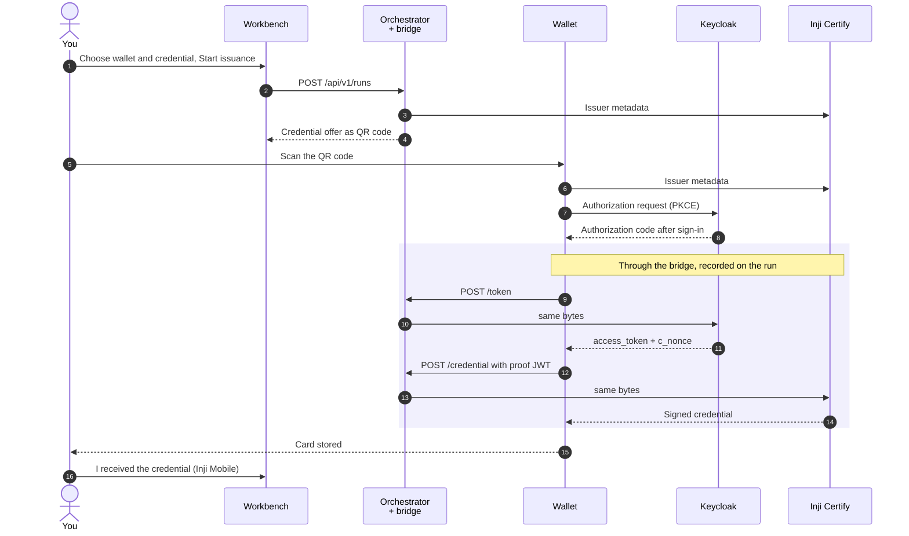
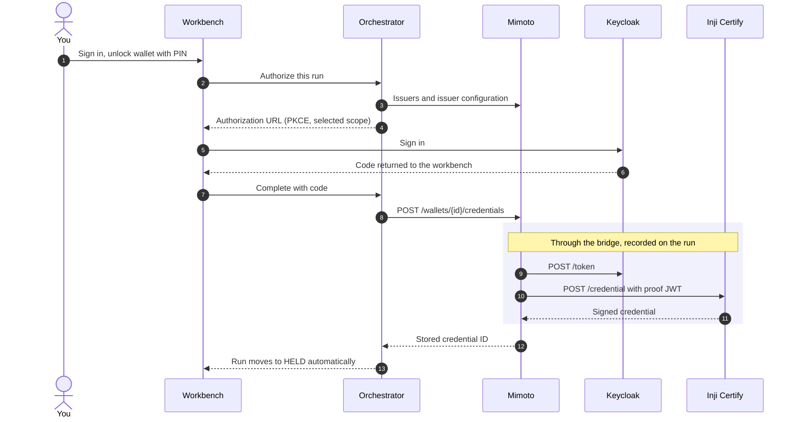
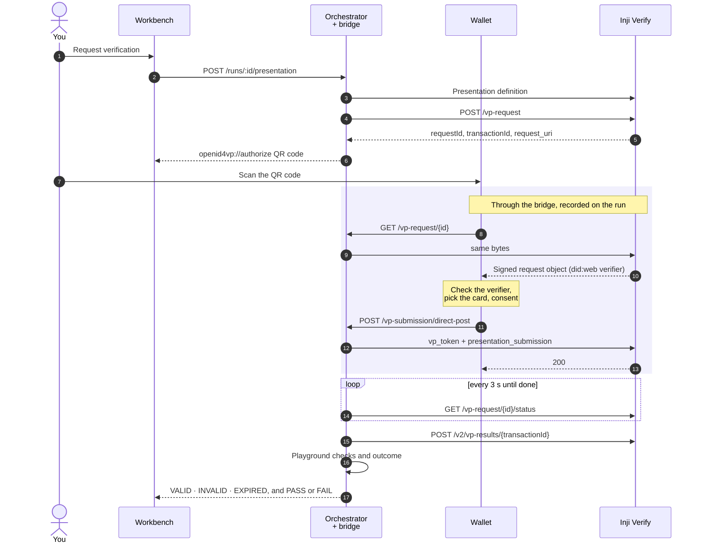
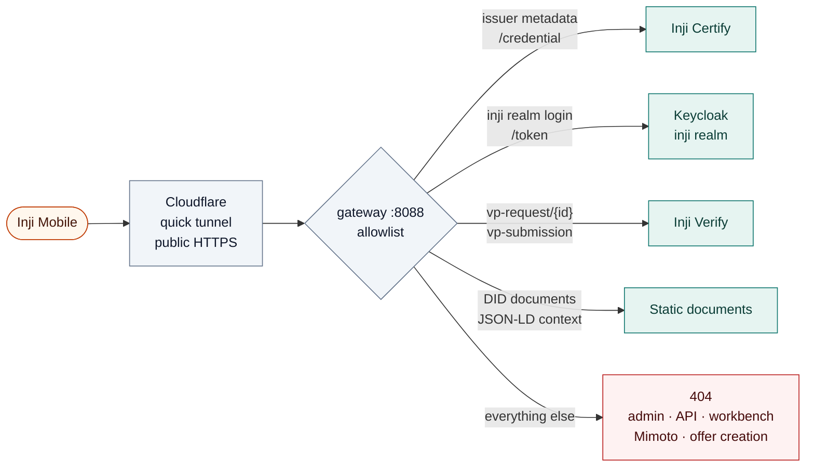
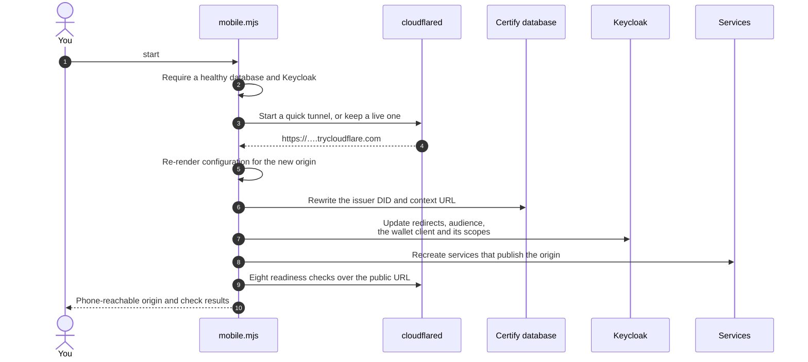

# Protocol flows

How a credential travels through the playground, step by step, and what the inspector shows at each step. The architecture behind these flows is in [ARCHITECTURE.md](ARCHITECTURE.md).

Every flow has two halves:

1. **Issue and hold** with OpenID4VCI (draft 13): Inji Certify issues a credential to the wallet.
2. **Present and verify** with OpenID4VP and Presentation Exchange 2.0: the wallet presents it to Inji Verify, and the playground collects the result.

## What the inspector captures

The problem statement asks the inspector to expose these payloads. This is where each one appears.

| Step | Event in the inspector | Source |
| --- | --- | --- |
| Issuer discovery | **Issuer metadata** | Orchestrator call |
| Credential offer | **Credential offer for Inji Mobile**, or the offer you pasted | Playground |
| Authorization request | **Mock wallet authorization request** (mock wallet) or Mimoto's authorization call (embedded wallet). Inji Mobile and Inji Web build theirs inside the wallet, so it is not visible. | Wallet |
| Token exchange | **authorization: /protocol/openid-connect/token** (code and verifier redacted) | Bridge |
| Proof of possession | The `proof.jwt` in the **certify: /credential** request; the mock wallet also logs it decoded | Bridge |
| Issued credential | The **certify: /credential** response, decodable as JWT / SD-JWT | Bridge |
| `presentation_definition` | **Presentation definition** and **Presentation request** | Orchestrator call |
| Request object | **verify: /vp-request/…**, the signed request the wallet fetched | Bridge |
| User authorization | Mimoto's presentation approval (embedded wallet). On a phone, consent happens in the app. | Wallet |
| `vp_token` + `presentation_submission` | **verify: /vp-submission/direct-post** | Bridge |
| Verification decision | **Presentation status** and **Verification checks (Inji v2)**, then the playground's own checks on the result card | Orchestrator call |

## Issue and hold: wallets that hold their own keys

Inji Mobile and the playground mock wallet both keep their keys and run OpenID4VCI themselves. The wire flow is the same. Inji Mobile signs in with the public client `wallet`; the mock wallet uses `playground-mock-wallet` and proves possession with a fresh `did:jwk` key.

The offer carries only `credential_issuer` and `credential_configuration_ids`, with no grants, which tells the wallet to use the authorization code flow with the authorization server in the issuer's metadata. Inji Mobile 0.22 splits the offer query on `=`, so the whole offer is percent-encoded. You can also paste an offer from another issuer.

## Issue and hold: the embedded Inji wallet

In **Inji wallet · in this page**, Mimoto holds the keys and speaks OpenID4VCI to Certify. The workbench drives Mimoto's own wallet APIs, so the session cookies, CSRF protection, key management and storage are Mimoto's.

The authorization state is bound to the Mimoto session, expires after ten minutes and can be used once. PINs never reach the orchestrator's storage or telemetry. **Inji Web · external** uses the same Mimoto path from its own tab; you start the download there and confirm receipt in the workbench.

## Present and verify

All four wallets share this flow. The orchestrator creates the request through Verify's API; the wallet fetches and answers it through the bridge.

- The request is sent by reference: the QR code carries `client_id` (the verifier's `did:web`) and `request_uri`, never the full request.
- Request creation must return `requestId`, `transactionId`, and either `requestUri` or `authorizationDetails`. The result from `/v2/vp-results` must name the same transaction, carry a boolean `allChecksSuccessful`, and contain exactly one credential result with its signature, expiry, holder-proof and status checks. An incompatible or inconsistent response fails explicitly.
- Inji Mobile sends a single SD-JWT `vp_token` as a JSON string, in quote marks; other wallets send it bare. Verify and the playground's checks accept both.
- Result collection runs on the server, so it continues if you leave the workbench. Transient failures stay visible on the run and are retried.
- The playground then runs its own checks on the submission. [SCENARIOS.md](SCENARIOS.md) shows how they combine into the outcome.

### Same-device presentation

Cross-device QR scanning is the main path. The same request also works on one device:

| Wallet | Same-device action |
| --- | --- |
| Inji Mobile | **Open wallet** opens the same `openid4vp://` link on the phone. |
| Inji Web | **Present with Inji Web** opens its `/authorize` page with the request. |
| Embedded Inji wallet | Review the verifier and credential, then **Approve and share credential** on the page. |
| Mock wallet | **Present with mock wallet**. |

The W3C Digital Credentials API is not implemented.

## Inji Mobile on a phone: mobile mode

A phone cannot reach `inji.127.0.0.1.sslip.io`, and Inji Mobile only trusts publicly issued TLS certificates. `node infra/inji/scripts/mobile.mjs start` publishes a separate allowlisted listener through a Cloudflare quick tunnel and moves the stack's identity to the tunnel URL.

As on the local origin, `/token`, `/credential`, `vp-request` and `vp-submission` pass through the bridge. The workbench itself stays on `http://localhost:5173`. Paths containing `;` are refused, because the Java services would resolve them differently from nginx. Mimoto is not published: a stock Inji Mobile uses the backend built into the app for its settings and asks you to trust an issuer or verifier it does not list.

Switching the identity touches every place that names the origin:

`stop` runs the same switch back to the `.env` origin and removes the tunnel. Each switch starts from the origin last applied to the database and realm, so rerunning an interrupted `start` or `stop` completes it. `status` reruns the readiness checks and reports a dropped tunnel or an unfinished switch. `rehearse` drives a full run over the public URL with a simulator built from the Inji Mobile 0.22.1, `inji-vci-client` 0.7.0 and `inji-openid4vp` 0.7.0 sources. The same flow passed with the real app on an Android phone on 1 November 2026.

The readiness checks replay the app's lookups:

1. Issuer metadata advertises a single authorization server.
2. Authorization server discovery returns an exact `issuer` match.
3. The `wallet` client's login page loads with its redirect URI.
4. The issuer DID document resolves.
5. The DID Certify signs with, read from its database, matches the issuer DID.
6. The verifier DID document resolves.
7. The JSON-LD context is reachable.
8. Local-only paths return 404.

The full phone steps, with screenshots, are in the [README](../README.md#inji-mobile-on-a-phone).
