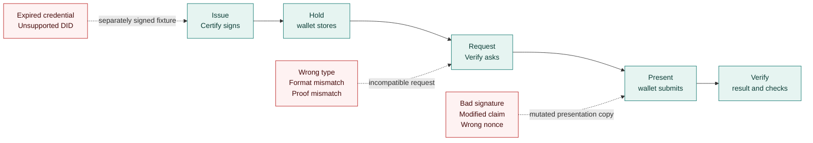
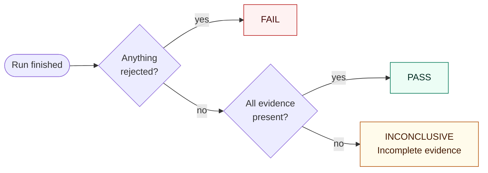
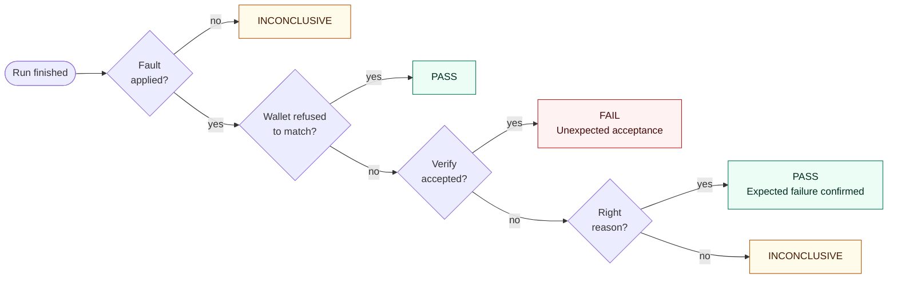

# Negative scenarios and outcomes

The problem statement asks for a "replay & tamper" mode that shows how Inji Verify handles broken credentials and presentations. This document explains each scenario, where it acts, and how the playground decides whether a run passed.

## Run a scenario

On the Workbench, choose a **Test scenario** under flow configuration and run the flow as usual. Unsupported combinations are disabled, with the reason shown. The normal flow is the default.

To repeat a finished run with a fault, open **Rerun with a scenario** on its result card. The replay is a new, linked run (`parentRunId`) with fresh issuance and a fresh verifier request; it never resends an old `vp_token` or moves wallet keys between sessions.

## Where each scenario acts

| Scenario | How it is produced | Wallets |
| --- | --- | --- |
| **Bad signature** | Corrupts a signature in a copy of the presentation; the wallet's stored credential is untouched. JSON-LD is mutated on the correlated submission at the bridge, whichever Inji wallet sent it. SD-JWT is mutated inside the mock wallet before it signs its Key Binding JWT. | Inji wallets (JSON-LD), mock wallet (SD-JWT) |
| **Modified claim** | Changes a signed claim without re-signing it, in the same places. | Inji wallets (JSON-LD), mock wallet (SD-JWT) |
| **Expired credential** | Certify signs the separate `FarmerCredentialExpired` configuration with January 2020 dates. Nothing is edited after signing. | JSON-LD wallets |
| **Unsupported DID** | Certify signs the separate `FarmerCredentialUnsupportedDid` fixture whose issuer is `did:playground:unresolvable-issuer`. The report shows the stage where it actually failed. | JSON-LD wallets |
| **Wrong credential type, format or proof** | A fresh verifier request asks for something the issued credential does not satisfy. A wallet that refuses to match is recorded separately from a verifier rejection. The mock wallet deliberately submits anyway, to test the verifier's own enforcement. | All |
| **Wrong nonce** | The mock wallet signs its SD-JWT Key Binding JWT with a nonce different from the request's. | Mock wallet |

**QR size limit** is not a run: the workbench applies a 2000-byte QR policy to every handoff and switches longer offers and requests to a copyable link. The catalog keeps it to explain that policy.

## Three answers per run

A run records three separate answers, and the workbench never merges them into one:

| Answer | Values | Comes from |
| --- | --- | --- |
| **Verdict** | VALID · INVALID · EXPIRED · ERROR | Inji Verify's overall and per-credential results |
| **Interoperability outcome** | PASS · FAIL · INCONCLUSIVE · PENDING · CANCELLED | Verify's result plus the playground's own checks and issuance evidence |
| **Scenario outcome** (negative scenarios) | PASS · FAIL · INCONCLUSIVE | Whether the system rejected the fault for the right reason |

HTTP 200 is delivery, not acceptance. An HTTP error or a service outage never passes anything, and stopping a local run does not revoke an offer or cancel an upstream presentation request.

Inji Verify supplies the cryptographic results; the inspector decodes JWTs for readability only. The playground's own checks cover request bindings, supported constraints and SD-JWT key binding. When they fail, Verify's acceptance stays on the record next to them rather than being hidden. One passing run is evidence for that combination, not a claim of complete standards conformance.

### Normal flow

| Question | Means |
| --- | --- |
| Anything rejected? | The run failed, Verify returned INVALID or EXPIRED, or any check failed. |
| All evidence present? | Verify accepted the presentation, every check passed, the bridge saw the credential issued, the presented credential matches it, and holder receipt was recorded. |

"Every check" means Verify's issuer signature, expiry and holder-proof checks, and the playground's independent checks on the submission: state, presentation definition, nonce, audience, issued format, descriptor ID and path, requested format, proof and claims, holder binding and result correlation. Credential status counts when Verify reports it and is marked not applicable when Verify returns no status entries; it is never reported as a successful revocation check.

### Negative scenarios

- **Fault applied?** The mutation, fixture or incompatible request was actually used. A fault that never reached the wallet or verifier proves nothing.
- **Wallet refused to match?** For wrong type, format or proof, a wallet that declines to present is a correct result, if the playground confirms the issued credential really does not satisfy the request.
- **Verify accepted?** Acceptance of a faulty presentation is a FAIL, shown as *Unexpected acceptance*.
- **Right reason?** A rejection counts only when the targeted check failed and everything else about the credential passed:

| Scenario | Rejection counts when |
| --- | --- |
| Bad signature, modified claim | The detailed signature error appears and is correlated with the submission. For claims, the original credential verifies while the modified copy is rejected. |
| Expired credential | The issued credential matches, issuer and holder signatures pass, the expiry check fails and the request bindings are intact. |
| Wrong type, format or proof | The playground check for that requirement fails, the credential is confirmed not to satisfy it, and Verify found nothing else wrong with the credential. |
| Wrong nonce | The playground's nonce check confirms the wrong nonce was sent, the issuer signature is valid and every other binding passes. |
| Unsupported DID | Only a precise rejection reason counts; a generic wallet error stays INCONCLUSIVE. |

A generic INVALID confirms a rejection but does not prove the cryptographic reason. Changing a credential inside a signed JSON-LD presentation can invalidate both proofs.

## How issuance and presentation are matched

The playground proves that the credential presented is the one it saw issued in the same run:

- **JSON-LD:** a deterministic structural fingerprint of the credential, independent of key order. This is a comparison, not a new cryptographic verification.
- **SD-JWT:** the issuer-signed JWT, so selective disclosure does not break the match.

A run that Verify accepted but whose issuance was not observed shows **Incomplete evidence**, not a pass.

## Reports

**Export report** on the result card, or in Run history, downloads a version 3 JSON report (`GET /api/v1/runs/:id/report`). It includes:

- the wallet, the issuer and verifier endpoints, the credential configuration with its format and proof types, and the stack version;
- `verdict`, `interoperabilityOutcome`, `scenarioResult`, `expectedResult` and the top-level `outcome`, which is the scenario outcome for negative scenarios;
- every captured event, the verification checks with details, and any error;
- the scenario's before-and-after evidence;
- the limits of what the run can prove.

Secrets are redacted. History lives in memory, so export reports you want to keep before restarting the server.

## Older local stacks

Fresh installations include the signed fixtures and Keycloak scopes. To bring a stack created before these features up to date without resetting its data, run `npm run upgrade` while it is running. It makes the normal JSON-LD scope optional instead of default, because this Certify release can stop at an unrelated default credential scope, and it restarts Mimoto, so sign in again afterwards.
