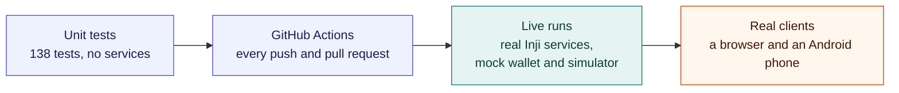

# Test cases and results

What was tested, what happened, and how to repeat it. Every live result names the run or date it comes from. Dated detail is in the [validation record](LIVE_VALIDATION.md), and sample data is in [TEST_DATA.md](TEST_DATA.md).

**Last full check:** 2 November 2026 on macOS (Apple silicon) with Colima 6 CPU / 12 GiB and Docker 29.5, against Certify 0.14.0, Mimoto 0.21.0, Inji Web 0.16.0 and Verify 0.17.0. Earlier results also ran on Linux x86_64.

## Results at a glance

| Group | Cases | ✅ As expected | 🔎 Inji gap found | 🟡 Partial | ⏳ Not run |
| --- | --- | --- | --- | --- | --- |
| [Automated tests](#automated-tests) | 138 tests | 138 | | | |
| [End-to-end journeys](#end-to-end-journeys) | 19 | 15 | 2 | 1 | 1 |
| [Negative scenarios](#negative-scenarios) | 13 | 8 | 4 | 1 | |
| [Edge cases and reliability](#edge-cases-and-reliability) | 22 | 22 | | | |

**🔎 means the test worked and found a real problem.** For example, the wrong-nonce test expects Inji Verify to reject the presentation. It accepts it, and that finding is the result. These are written up in the [gap report](INTEROP_GAPS.md).

## How it is tested



Run the checks yourself from the repository root:

```bash
(cd server && npm ci && npm run typecheck && npm test && npm run build)
(cd client && npm ci && npm run lint && npm run build)
node --test "infra/inji/scripts/tests/*.test.mjs"
```

## Automated tests

All 138 pass, along with the server type check and build, and the client lint and build. [GitHub Actions](../.github/workflows/ci.yml) runs them on every push and pull request.

| Area | Tests | What they prove |
| --- | --- | --- |
| Scenario and outcome rules | 30 | Scoring for each scenario, including that an outage or undone check can never pass a negative scenario, and which wallets may run mDoc |
| Run workflow | 27 | Offers, starting runs, verification errors and retries, fingerprints, mDoc decoding and the direct mDoc check |
| Protocol bridge | 19 | Path allowlist, byte-for-byte forwarding, upstream failures, observer errors never replacing a response, retryable proofs, mDoc capture |
| Mock wallet | 15 | Verifier request authentication, including bad signatures and wrong client, endpoint or nonce; SD-JWT binding |
| Telemetry | 10 | Secret redaction, payload limits, merging repeated polls |
| Inji adapters | 5 | Presentation links, malformed request URIs, the direct credential check |
| Run storage | 5 | The 100-run limit and copy isolation |
| Phone reachability | 3 | Which origins a phone can reach |
| Infrastructure scripts | 24 | Rendering configuration, readiness checks, the mobile identity switch, the app's mDoc checks |

## End-to-end journeys

| ID | Case | Expected | Actual | Result | Evidence |
| --- | --- | --- | --- | --- | --- |
| F01 | Start the stack with one command | All services start and report healthy | 12 services up; all health checks healthy | ✅ | 2 Nov |
| F02 | Discover issuer credentials | All configurations listed with format and proof | 5 listed, including all three formats | ✅ | 2 Nov |
| F03 | Embedded Inji wallet, JSON-LD | VALID, PASS | VALID, PASS, issuance matched | ✅ | `c1c81eea`, in Chrome, 29 Oct |
| F04 | Self-registered account, JSON-LD | New account issues and verifies | VALID, PASS, one synthetic record | ✅ | `be7866e6`, 26 Oct |
| F05 | Inji Web in its own tab, JSON-LD | VALID, PASS | VALID, PASS | ✅ | `23560c16`, 21 Oct |
| F06 | Mock wallet (non-Inji), SD-JWT | VALID, PASS | VALID, PASS | ✅ | `5938d96b`, 2 Nov |
| F07 | **Inji Mobile on a physical Android phone, SD-JWT** | VALID, PASS | VALID, PASS; every check passes | ✅ | `2e588e58`, 1 Nov |
| F08 | Simulated Inji Mobile over a real tunnel, SD-JWT | VALID, PASS | VALID, PASS | ✅ | `ebde8bb9`, 2 Nov |
| F09 | Simulated Inji Mobile, JSON-LD | Issued; verifier request authenticated | As expected. Signing the presentation needs the real app. | 🟡 | `4b36e562`, 2 Nov |
| F10 | Inji Mobile on a phone, mDoc | Card stored in the app | Card stored and readable; storage checks pass | ✅ | `baf94774`, 1 Nov |
| F11 | Send the issued mDoc to Inji Verify | Verified, or a clear unsupported error | INVALID with a JSON parsing error | 🔎 [V4](INTEROP_GAPS.md#inji-verify-017) | `1ab07218`, 2 Nov |
| F12 | Inji Web, SD-JWT | Issued and presented | Stored, then presentation fails inside Mimoto | 🔎 [M1](INTEROP_GAPS.md#mimoto-021-and-inji-web-016) | 21 Oct |
| F13 | Inspector shows each exchange | Offer, token, proof, credential, definition, `vp_token` and result, with secrets redacted | All present | ✅ | `5938d96b`, 2 Nov |
| F14 | Live sequence diagram | Draws the run, opens payloads | Inji Mobile lane, 12 events, no browser errors | ✅ | `2e588e58`, 1 Nov |
| F15 | Export a report | Issuer, wallet, verifier, format, proof, outcome, error; secrets removed | All present, version 3 | ✅ | [Report](evidence/mobile-phone-2026-11-01.json) |
| F16 | Run history filters | Outcome, format, scenario and version narrow the list | Correct counts, an empty state, and a report download | ✅ | Chromium, 2 Nov |
| F17 | Replay a finished run with a fault | New linked run with fresh issuance | Linked run; no old presentation reused | ✅ | `8b6bb1d7`, 29 Oct |
| F18 | Collect a result with no browser open | Server finishes the run alone | Completed with no client requests | ✅ | `5af34750`, 26 Oct |
| F19 | Same-device link on a phone | **Open wallet** opens the app | | ⏳ | |

## Negative scenarios

Each one deliberately breaks something. A correct rejection is ✅. Acceptance of the fault is 🔎.

| ID | Scenario | Wallet · format | Expected | Actual | Result | Evidence |
| --- | --- | --- | --- | --- | --- | --- |
| N01 | Bad signature | Embedded · JSON-LD | Rejected | INVALID, holder proof `ERR_SIGNATURE_VERIFICATION_FAILED` | ✅ | `63dfef98`, 29 Oct |
| N02 | Bad signature | Mock · SD-JWT | Rejected | INVALID, issuer signature failed | ✅ | `0d5bc4be`, 2 Nov |
| N03 | Modified claim | Embedded · JSON-LD | Rejected | INVALID | ✅ | [26 Oct](evidence/negative-scenarios-2026-10-26.json) |
| N04 | Modified claim | Mock · SD-JWT | Rejected | INVALID | ✅ | `c6cd200a`, 2 Nov |
| N05 | Expired credential | Embedded · JSON-LD | EXPIRED | EXPIRED; signatures valid, expiry failed | ✅ | [26 Oct](evidence/negative-scenarios-2026-10-26.json) |
| N06 | Wrong credential type | Embedded · JSON-LD | Refused or rejected | Wallet refused to match | ✅ | [26 Oct](evidence/negative-scenarios-2026-10-26.json) |
| N07 | Format mismatch | Embedded · JSON-LD | Refused or rejected | Wallet refused to match | ✅ | [26 Oct](evidence/negative-scenarios-2026-10-26.json) |
| N08 | Proof-type mismatch | Embedded · JSON-LD | Refused or rejected | Wallet refused to match | ✅ | [26 Oct](evidence/negative-scenarios-2026-10-26.json) |
| N09 | Wrong credential type | Mock · SD-JWT | Rejected by Verify | **VALID: accepted** | 🔎 [V2](INTEROP_GAPS.md#inji-verify-017) | `b0ed89f4`, 2 Nov |
| N10 | Format mismatch | Mock · SD-JWT | Rejected by Verify | **VALID: accepted** | 🔎 [V2](INTEROP_GAPS.md#inji-verify-017) | `eb92964c`, 2 Nov |
| N11 | Proof-type mismatch | Mock · SD-JWT | Rejected by Verify | **VALID: accepted** | 🔎 [V2](INTEROP_GAPS.md#inji-verify-017) | `aef96af7`, 2 Nov |
| N12 | Wrong nonce | Mock · SD-JWT | Rejected by Verify | **VALID: accepted**; the playground's nonce check fails | 🔎 [V1](INTEROP_GAPS.md#inji-verify-017) | `4297daba`, 2 Nov |
| N13 | Unsupported DID | Embedded · JSON-LD | A precise rejection | Mimoto storage HTTP 500, so no precise reason | 🟡 [M10](INTEROP_GAPS.md#mimoto-021-and-inji-web-016) | [26 Oct](evidence/negative-scenarios-2026-10-26.json) |

## Edge cases and reliability

| ID | Case | Expected | Result | Evidence |
| --- | --- | --- | --- | --- |
| E01 | Unknown wallet, scenario or credential | 422 with the reason | ✅ | 2 Nov |
| E02 | Unsupported pairs: mock wallet with JSON-LD, embedded wallet with SD-JWT, Inji Web with mDoc | 422 with the reason | ✅ | 2 Nov |
| E03 | Unavailable scenarios: wrong nonce or bad signature on Inji Mobile, a fault on mDoc | 422 with the reason | ✅ | 2 Nov |
| E04 | Credential offer given to a wallet that cannot redeem one | 422 | ✅ | 2 Nov |
| E05 | Start a second run while one is active | 409 | ✅ | 2 Nov |
| E06 | Request verification before receipt | 409 | ✅ | 2 Nov |
| E07 | Confirm receipt by hand on a wallet that reports it itself | 409 | ✅ | 2 Nov |
| E08 | Wrong content type, malformed JSON | 415, 400 | ✅ | 2 Nov |
| E09 | Unknown run or endpoint | 404 with a clear message | ✅ | 2 Nov |
| E10 | API request from a foreign origin | 403 | ✅ | 2 Nov |
| E11 | WebSocket from a foreign origin, or with none | Connection refused; allowed origin receives `connected` | ✅ | 2 Nov |
| E12 | Embedded wallet API without XSRF token, or from another origin | 403 | ✅ | 2 Nov |
| E13 | Bridge: path outside the allowlist, encoded traversal, `DELETE` | 404 | ✅ | 2 Nov |
| E14 | Public tunnel: admin console, API, workbench, Mimoto, offer creation | 404; readiness check passes | ✅ | 8/8 checks, 2 Nov |
| E15 | Public tunnel: `;` path parameters, `..;/`, actuator paths | 404 from nginx | ✅ | 28 Oct |
| E16 | Quick tunnel dropped by Cloudflare after 7 hours | `status` reports it; `start` recovers on a new URL | ✅ | 28 Oct |
| E17 | `stop` interrupted partway | `status` reports it; rerunning completes it | ✅ | 28 Oct |
| E18 | `start` with Keycloak stopped, or an invalid `--origin` | Refused; nothing changed | ✅ | 28 Oct |
| E19 | Network blocks QUIC (UDP) | Tunnel connects over HTTP/2 with `TUNNEL_TRANSPORT_PROTOCOL=http2` | ✅ | 1 Nov |
| E20 | `stop` after a session | Local origin restored; the workbench and Inji Web answer | ✅ | 2 Nov |
| E21 | Request too large for a QR code | Workbench switches to a copyable link | ✅ | 2,202-byte sample, 26 Oct |
| E22 | Secrets in reports and evidence | Tokens, codes and PINs redacted | ✅ | Unit tests; [report](evidence/mobile-phone-2026-11-01.json) |

## Bugs that testing found and fixed

| Found by | Bug | Fix |
| --- | --- | --- |
| First phone run, `bfe243ce` | The app sends an SD-JWT `vp_token` in quote marks, which made the playground's hash and match checks fail | Checks decode it; the simulator now sends it the same way |
| First mDoc run, `0b3201a8` | Certify's tagged COSE `issuerAuth` left the mDoc unobserved | Decoder fixed; tests added |
| Chrome, 29 Oct | Mimoto rejected the browser's `Accept-Language` list | Client sends `en` ([M5](INTEROP_GAPS.md#mimoto-021-and-inji-web-016)) |
| Chrome, 29 Oct | A locked wallet showed an error instead of the PIN form | `wallet_locked` routes to unlock ([M6](INTEROP_GAPS.md#mimoto-021-and-inji-web-016)) |
| Dropped tunnel, 28 Oct | `start` reused a dead URL | It keeps only a URL that answers |
| Interrupted run, 28 Oct | A failed `start` or `stop` could not be repaired by rerunning it | Switching starts from the origin last applied |
| Probes, 28 Oct | `;` path parameters reached Mimoto through the public listener | Refused by nginx; Mimoto no longer published |
| Code review | A service outage could pass a negative scenario | A rejection counts only when Inji found the credential otherwise sound |

## Not tested

| Area | Status |
| --- | --- |
| JSON-LD presentation from Inji Mobile on a phone | Not run. Issuance and request authentication pass with the simulator. |
| Same-device link on a phone | Not run. |
| iOS and Windows | Not run. |
| OpenID4VP presentation of mDoc | Not possible: Inji Verify 0.17 has no path for it. |
| Embedded wallet and Inji Web on the 2 November build | Last run in a browser on 29 and 21 October. Their server paths are unchanged and covered by unit tests. |
